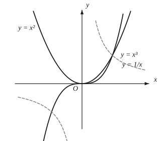
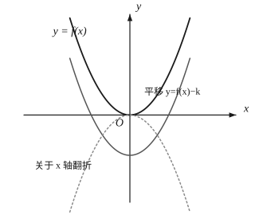

# 1.2 复合函数与初等函数

现实中的函数很少是“一层”的。气温随时间变化，时间又随季节变化；一个圆的面积是半径的函数，半径又可能是边长的函数。把简单函数一层层套起来，就得到复合函数。反过来，把一个复杂的函数拆成几层简单函数，是求导和积分的基本功。这一节先讲“怎么套、怎么拆”，再把六类基本初等函数的图像与性质系统梳理一遍——它们是整个高等数学的积木。

## 一、复合函数：函数的函数

**定义 1.1（复合函数）** 设函数 $y=f(u)$ 的定义域为 $D_f$，函数 $u=\varphi(x)$ 的定义域为 $D_\varphi$，值域为 $R_\varphi$。如果 $R_\varphi\cap D_f\neq\varnothing$，则对满足 $\varphi(x)\in D_f$ 的 $x$，可以确定唯一的 $y$，记
$$
y=f[\varphi(x)],
$$
称为由 $y=f(u)$ 与 $u=\varphi(x)$ 复合而成的**复合函数**，$u$ 称为**中间变量**。

复合函数的定义域是
$$
\{x\mid x\in D_\varphi,\ \varphi(x)\in D_f\}.
$$
注意它不一定是 $D_\varphi$ 的全部，因为还要让内层函数的值落进外层函数的定义域。

**例 1.1** 设 $f(u)=\sqrt{u}$，$\varphi(x)=1-x^2$，求 $f[\varphi(x)]$ 的定义域。

**解** 复合函数为 $y=\sqrt{1-x^2}$。要求 $1-x^2\ge 0$，即 $-1\le x\le 1$。所以定义域为 $[-1,1]$。

如果外层是 $f(u)=\ln u$，内层仍是 $\varphi(x)=1-x^2$，则要求 $1-x^2>0$，定义域变成 $(-1,1)$。**外层函数的定义域决定了内层函数值域的限制**，这是求复合函数定义域的关键。

**例 1.2** 分解下列函数的复合结构：
（1）$y=\sin^2(2x+1)$；
（2）$y=e^{\sqrt{x^2+1}}$；
（3）$y=\ln\cos\sqrt{x}$。

**解** （1）$y=u^2$，$u=\sin v$，$v=2x+1$。
（2）$y=e^u$，$u=\sqrt{v}$，$v=x^2+1$。
（3）$y=\ln u$，$u=\cos v$，$v=\sqrt{x}$。

分解不必强求“分解到最基本”，只要每一层都是熟悉的基本初等函数即可。求导时，每剥一层就要乘上这一层的导数，所以分解得越清楚，越不容易漏乘。

**例 1.3** 已知 $f(x+1)=x^2+2x$，求 $f(x)$。

**解** 令 $t=x+1$，则 $x=t-1$。代入得
$$
f(t)=(t-1)^2+2(t-1)=t^2-2t+1+2t-2=t^2-1.
$$
所以 $f(x)=x^2-1$。

这类“已知 $f(g(x))$ 求 $f(x)$”的题，核心就是换元：把内层整体设成 $t$，反解出 $x$，再代回。注意最后要把 $t$ 换回 $x$，并且写出定义域（本题为 $\mathbb{R}$）。

## 二、六类基本初等函数

基本初等函数有六类：常数函数、幂函数、指数函数、对数函数、三角函数、反三角函数。考纲要求“掌握基本初等函数的性质及其图形”，这句话的分量很重——后面的极限、导数、积分，几乎都要以它们的图像和性质为背景。

### 1. 常数函数

$y=C$（$C$ 为常数），定义域 $\mathbb{R}$，值域 $\{C\}$。图像是平行于 $x$ 轴的水平直线。它既是偶函数，也是周期函数（任意正数都是周期），但没有最小正周期。

### 2. 幂函数

*图 1-4 常见幂函数图像*

$y=x^\alpha$（$\alpha$ 为常数）。它的定义域随 $\alpha$ 变化，需要分情况记忆：

- 当 $\alpha$ 为正整数时，定义域为 $\mathbb{R}$；
- 当 $\alpha=\dfrac{1}{n}$（$n$ 为正偶数）时，如 $y=\sqrt{x}$，定义域为 $[0,+\infty)$；
- 当 $\alpha=-1$ 时，$y=\dfrac{1}{x}$，定义域为 $\mathbb{R}\setminus\{0\}$；
- 当 $\alpha<0$ 时，图像在第一象限单调递减，并以两坐标轴为渐近线。

所有幂函数在 $(0,+\infty)$ 上都有定义，且都经过点 $(1,1)$。在 $x>1$ 时，$\alpha$ 越大，$x^\alpha$ 越大；在 $0<x<1$ 时正好相反，$\alpha$ 越大，$x^\alpha$ 越小。记住这个“分界点 $x=1$”，就不会把 $y=x^2$ 与 $y=\sqrt{x}$ 的上下关系搞反。

常见的三条图像要能随手画出：$y=x^2$（抛物线）、$y=x^3$（立方曲线，奇函数）、$y=\dfrac{1}{x}$（双曲线，奇函数）。

### 3. 指数函数

$y=a^x$（$a>0$，$a\neq 1$），定义域 $\mathbb{R}$，值域 $(0,+\infty)$，恒过点 $(0,1)$，以 $x$ 轴为水平渐近线。

- 当 $a>1$ 时，函数单调递增，$x\to-\infty$ 时 $y\to 0^+$，$x\to+\infty$ 时 $y\to+\infty$；
- 当 $0<a<1$ 时，函数单调递减，$x\to-\infty$ 时 $y\to+\infty$，$x\to+\infty$ 时 $y\to 0^+$。

自然指数 $y=e^x$（$e\approx 2.71828$）是最重要的一条，它的导数等于自身，这个性质到第二章会反复出现。

### 4. 对数函数

$y=\log_a x$（$a>0$，$a\neq 1$），定义域 $(0,+\infty)$，值域 $\mathbb{R}$，恒过点 $(1,0)$，以 $y$ 轴为垂直渐近线。它与同底的指数函数互为反函数，图像关于 $y=x$ 对称。

- 当 $a>1$ 时单调递增；当 $0<a<1$ 时单调递减。
- 自然对数记作 $\ln x=\log_e x$，常用对数记作 $\lg x=\log_{10} x$。

对数运算有三条最常用的性质：
$$
\log_a(MN)=\log_a M+\log_a N,\qquad
\log_a\frac{M}{N}=\log_a M-\log_a N,\qquad
\log_a M^n=n\log_a M.
$$
在求导、求极限时，$\ln(1+x)\sim x$（$x\to 0$）也是一个高频结论，第五章会详细讲。

### 5. 三角函数

- $y=\sin x$：定义域 $\mathbb{R}$，值域 $[-1,1]$，奇函数，周期 $2\pi$，在 $\left[-\dfrac{\pi}{2}+2k\pi,\dfrac{\pi}{2}+2k\pi\right]$ 上递增。
- $y=\cos x$：定义域 $\mathbb{R}$，值域 $[-1,1]$，偶函数，周期 $2\pi$，在 $[2k\pi,(2k+1)\pi]$ 上递减。
- $y=\tan x$：定义域 $x\neq\dfrac{\pi}{2}+k\pi$，值域 $\mathbb{R}$，奇函数，周期 $\pi$，在每个区间内单调递增，有垂直渐近线 $x=\dfrac{\pi}{2}+k\pi$。
- $y=\cot x$：定义域 $x\neq k\pi$，值域 $\mathbb{R}$，奇函数，周期 $\pi$，在每个区间内单调递减。

必须熟记特殊角的函数值：

| $x$ | $0$ | $\dfrac{\pi}{6}$ | $\dfrac{\pi}{4}$ | $\dfrac{\pi}{3}$ | $\dfrac{\pi}{2}$ |
| --- | --- | --- | --- | --- | --- |
| $\sin x$ | $0$ | $\dfrac12$ | $\dfrac{\sqrt2}{2}$ | $\dfrac{\sqrt3}{2}$ | $1$ |
| $\cos x$ | $1$ | $\dfrac{\sqrt3}{2}$ | $\dfrac{\sqrt2}{2}$ | $\dfrac12$ | $0$ |
| $\tan x$ | $0$ | $\dfrac{\sqrt3}{3}$ | $1$ | $\sqrt3$ | 不存在 |

常用恒等式：$\sin^2x+\cos^2x=1$，$\sin 2x=2\sin x\cos x$，$\cos 2x=\cos^2x-\sin^2x=1-2\sin^2x=2\cos^2x-1$。后两个在积分中用来降幂，非常常用。

### 6. 反三角函数

反三角函数是三角函数在**单调区间**上的反函数。因为三角函数是周期函数，整体上不是一一对应的，所以必须人为限制定义域。

- $y=\arcsin x$：定义域 $[-1,1]$，值域 $\left[-\dfrac{\pi}{2},\dfrac{\pi}{2}\right]$，单调递增，奇函数。
- $y=\arccos x$：定义域 $[-1,1]$，值域 $[0,\pi]$，单调递减，非奇非偶。
- $y=\arctan x$：定义域 $\mathbb{R}$，值域 $\left(-\dfrac{\pi}{2},\dfrac{\pi}{2}\right)$，单调递增，奇函数，有水平渐近线 $y=\pm\dfrac{\pi}{2}$。

一个容易错的点：$\arcsin(\sin x)=x$ 只在 $x\in\left[-\dfrac{\pi}{2},\dfrac{\pi}{2}\right]$ 时成立。例如 $\arcsin\left(\sin\dfrac{5\pi}{6}\right)=\arcsin\dfrac12=\dfrac{\pi}{6}$，而不是 $\dfrac{5\pi}{6}$。反三角函数的值域是“约定”出来的，做题时要先看角度是否落在约定区间内。

## 三、初等函数

**定义 1.2（初等函数）** 由常数和六类基本初等函数经过有限次四则运算和有限次复合，并且能用一个解析式表示的函数，称为**初等函数**。

多项式、有理函数、$y=\sqrt{1-x^2}$、$y=\ln(\sin x)$ 都是初等函数。分段函数一般不是初等函数，但 $|x|=\sqrt{x^2}$ 是初等函数，因为它可以写成一个解析式。

形如
$$
y=u(x)^{v(x)}\qquad (u(x)>0)
$$
的函数称为**幂指函数**，它既不是幂函数也不是指数函数。利用恒等式
$$
u(x)^{v(x)}=e^{v(x)\ln u(x)},
$$
可以把它化成初等函数。例如 $y=x^x=e^{x\ln x}$（$x>0$）。这个变形在求导和求极限时非常关键。

## 四、定义域与值域的求法

求定义域，就是把所有“限制条件”列出来，再取交集：

1. 分母不为零；
2. 偶次根号下的表达式非负；
3. 对数的真数为正；
4. $\arcsin$、$\arccos$ 的自变量在 $[-1,1]$ 内；
5. $\tan x$ 的自变量不等于 $\dfrac{\pi}{2}+k\pi$。

**例 1.4** 求 $y=\ln(\arcsin x)$ 的定义域。

**解** 要求 $\arcsin x>0$，且 $x\in[-1,1]$。$\arcsin x>0$ 等价于 $x>0$（因为 $\arcsin 0=0$，且 $\arcsin x$ 单调递增）。所以定义域为 $(0,1]$。

**例 1.5** 求 $y=\sqrt{x-1}+\sqrt{2-x}$ 的定义域与值域。

**解** 定义域由 $x-1\ge 0$ 且 $2-x\ge 0$ 确定，即 $[1,2]$。

求值域时，先看平方：
$$
y^2=(x-1)+(2-x)+2\sqrt{(x-1)(2-x)}=1+2\sqrt{(x-1)(2-x)}.
$$
设 $u=(x-1)(2-x)$。这是开口向下的二次函数，在 $x=\dfrac32$ 处取得最大值 $\dfrac14$，在端点 $x=1,2$ 处为 $0$。所以 $0\le u\le\dfrac14$，从而
$$
1\le y^2\le 1+2\cdot\frac12=2.
$$
又 $y\ge 0$，所以值域为 $[1,\sqrt2]$。

**例 1.6** 设 $f(x)$ 的定义域为 $[0,1]$，求 $g(x)=f(x+1)+f(x-1)$ 的定义域。

**解** 要求 $x+1\in[0,1]$ 且 $x-1\in[0,1]$，即 $x\in[-1,0]$ 且 $x\in[1,2]$。两个区间没有交集，所以 $g(x)$ 的定义域为空集，该函数不存在。

这类题很容易“只解一个不等式”就下结论。两个条件必须同时满足，取交集；交集为空就说明函数无意义。

## 五、图像的初等变换

*图 1-6 图像的平移与关于 x 轴翻折*

记住以下四种变换，可以快速由基本图像画出复杂函数的草图：

| 变换 | 效果 |
| --- | --- |
| $y=f(x)+b$ | 图像上下平移 $b$ 个单位 |
| $y=f(x+a)$ | 图像左右平移（$a>0$ 向左，$a<0$ 向右） |
| $y=af(x)$ | 纵向伸缩（$|a|>1$ 拉长，$0<|a|<1$ 压缩） |
| $y=f(-x)$ | 关于 $y$ 轴对称 |
| $y=-f(x)$ | 关于 $x$ 轴对称 |
| $y=|f(x)|$ | 把 $x$ 轴下方的部分翻到上方 |
| $y=f(|x|)$ | 保留 $y$ 轴右侧，再对称到左侧 |

这些变换在第三章函数作图时会直接用到。现在先把六类基本函数的“原图”记牢，变换才有依据。

## 六、考纲提示与小结

考纲要求：理解复合函数的概念；理解基本初等函数和初等函数的概念；掌握基本初等函数的性质及其图形。对应题型以选择题、填空题为主，常见考法是求定义域、判断复合结构、比较函数值大小、识别图像。

小结：

1. 复合函数的定义域要同时满足“内层有意义”和“内层值落在外层定义域内”。
2. 六类基本初等函数的“定义域、值域、特殊点、单调性、渐近线”是五件套，逐条记忆。
3. 幂指函数通过 $u^v=e^{v\ln u}$ 化为初等函数。
4. 反三角函数的值域是人为约定的，使用前先确认角的范围。
5. 图像变换“左加右减、上加下减”，绝对值变换先翻后对称。

下一节进入整个微积分的地基：极限。我们会从“无限逼近”的直觉出发，逐步说清楚 $\varepsilon$-$\delta$ 语言到底在说什么，以及为什么极限与函数在该点是否有定义无关。
