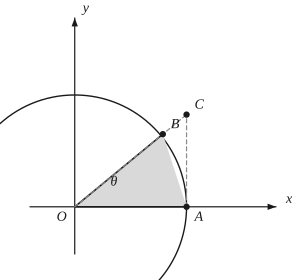

# 1.4 极限的运算法则与两个重要极限

用 $\varepsilon$-$\delta$ 定义证明极限，就像用放大镜看每一颗螺丝：严谨，但效率太低。真正做题时，我们靠的是一套运算法则，把复杂极限拆成已知极限的组合。这一节先建立四则运算法则，再讲两个“撑起半个微积分”的重要极限。它们之所以重要，是因为后面的导数公式几乎都要从它们推出来。

## 一、四则运算法则

**定理 1.1（极限的四则运算）** 设 $\lim\limits_{x\to x_0}f(x)=A$，$\lim\limits_{x\to x_0}g(x)=B$，且 $A,B$ 都是有限数，则
$$
\lim_{x\to x_0}[f(x)\pm g(x)]=A\pm B,
$$
$$
\lim_{x\to x_0}[f(x)g(x)]=AB,
$$
$$
\lim_{x\to x_0}\frac{f(x)}{g(x)}=\frac{A}{B}\qquad (B\neq 0).
$$

三条法则的前提是**两个极限都存在且有限**，商的法则还要求**分母极限不为零**。这两条前提经常被忽略，而考试恰恰喜欢在前提上设陷阱。

证明的思路并不复杂。以乘积为例，由定理 1.2（极限与无穷小的关系），可设
$$
f(x)=A+\alpha(x),\qquad g(x)=B+\beta(x),
$$
其中 $\alpha,\beta$ 都是无穷小。于是
$$
f(x)g(x)=AB+A\beta+B\alpha+\alpha\beta.
$$
后三项都是无穷小（有界量乘无穷小仍是无穷小），所以 $f(x)g(x)\to AB$。这个证明也说明了为什么“极限存在”是必要条件：如果 $f$ 或 $g$ 的极限不存在，拆开后的每一项就无从谈起。

由四则法则可以直接得到几个推论：

- $\lim [Cf(x)]=C\lim f(x)$（常数可以提出）；
- $\lim [f(x)]^n=[\lim f(x)]^n$（正整数次幂）；
- 多项式函数在任意点的极限等于该点的函数值；
- 有理函数在分母不为零的点，极限等于函数值。

**例 1.1** 求 $\lim\limits_{x\to 2}\dfrac{x^2+3x-1}{x+1}$。

**解** 分母 $2+1=3\neq 0$，直接代入：
$$
\frac{2^2+3\cdot 2-1}{2+1}=\frac{4+6-1}{3}=3.
$$

**例 1.2** 求 $\lim\limits_{x\to 1}\dfrac{x^2-1}{x^2-3x+2}$。

**解** 代入后分子、分母都为 $0$，属于 $\dfrac00$ 型。此时不能直接代入，要先约去零因子：
$$
\frac{x^2-1}{x^2-3x+2}=\frac{(x-1)(x+1)}{(x-1)(x-2)}=\frac{x+1}{x-2}\qquad (x\neq 1).
$$
所以
$$
\lim_{x\to 1}\frac{x^2-1}{x^2-3x+2}=\lim_{x\to 1}\frac{x+1}{x-2}=\frac{2}{-1}=-2.
$$

约去零因子是 $\dfrac00$ 型最基本的处理方法。它的合法性来自“极限是去心的”：$x\to 1$ 但 $x\neq 1$，所以可以约掉 $x-1$。

**例 1.3** 求 $\lim\limits_{x\to 0}\dfrac{\sqrt{1+x}-1}{x}$。

**解** 分子有理化：
$$
\frac{\sqrt{1+x}-1}{x}
=\frac{(\sqrt{1+x}-1)(\sqrt{1+x}+1)}{x(\sqrt{1+x}+1)}
=\frac{1+x-1}{x(\sqrt{1+x}+1)}
=\frac{1}{\sqrt{1+x}+1}.
$$
所以极限为 $\dfrac{1}{1+1}=\dfrac12$。

**例 1.4** 求 $\lim\limits_{x\to\infty}\dfrac{3x^2+2x-1}{2x^2-x+5}$。

**解** 分子、分母同除以 $x^2$：
$$
\frac{3+\dfrac{2}{x}-\dfrac{1}{x^2}}{2-\dfrac{1}{x}+\dfrac{5}{x^2}}\longrightarrow \frac{3}{2}\qquad (x\to\infty).
$$
所以极限为 $\dfrac32$。

一般地，有理函数在 $x\to\infty$ 时的极限，只看分子、分母的最高次项：分子次数低于分母，极限为 $0$；次数相等，极限为首项系数之比；分子次数高于分母，极限为无穷大（不存在）。

**例 1.5** 求 $\lim\limits_{x\to\infty}\left(\sqrt{x^2+x}-x\right)$。

**解** 这是 $\infty-\infty$ 型，先有理化：
$$
\sqrt{x^2+x}-x=\frac{(x^2+x)-x^2}{\sqrt{x^2+x}+x}=\frac{x}{\sqrt{x^2+x}+x}.
$$
分子、分母同除以 $x$（$x>0$）：
$$
\frac{1}{\sqrt{1+\dfrac1x}+1}\longrightarrow \frac{1}{1+1}=\frac12.
$$
所以极限为 $\dfrac12$。

**例 1.6** 求 $\lim\limits_{x\to 1}\left(\dfrac{1}{x-1}-\dfrac{2}{x^2-1}\right)$。

**解** 这是 $\infty-\infty$ 型，先通分：
$$
\frac{1}{x-1}-\frac{2}{x^2-1}
=\frac{x+1-2}{(x-1)(x+1)}
=\frac{x-1}{(x-1)(x+1)}
=\frac{1}{x+1}.
$$
所以极限为 $\dfrac12$。

## 二、复合函数的极限

如果 $\lim\limits_{x\to x_0}\varphi(x)=u_0$，而 $f$ 在 $u_0$ 处连续，则
$$
\lim_{x\to x_0}f[\varphi(x)]=f\left[\lim_{x\to x_0}\varphi(x)\right]=f(u_0).
$$
直观地说，**极限符号可以穿过连续函数**。例如
$$
\lim_{x\to 0}\ln(1+x)=\ln\left(\lim_{x\to 0}(1+x)\right)=\ln 1=0.
$$
但如果不连续，就不能随便穿。例如 $\lim\limits_{x\to 0^+}e^{1/x}$ 中，$e^u$ 在 $u\to+\infty$ 时没有有限极限，就不能写成 $e^{\lim(1/x)}$ 后直接代入。使用这条性质前，先确认外层函数在该点连续。

## 三、第一个重要极限：$\dfrac{\sin x}{x}$

*图 1-11 单位圆内面积夹逼*

**定理 1.2（第一个重要极限）**
$$
\lim_{x\to 0}\frac{\sin x}{x}=1.
$$

这个极限不能靠代入，因为代入得到 $\dfrac00$。它的证明要用到**夹逼定理**：如果 $g(x)\le f(x)\le h(x)$，且 $\lim g(x)=\lim h(x)=A$，则 $\lim f(x)=A$。

**几何证明** 在单位圆中，设圆心角 $\angle AOB=x$（$0<x<\dfrac{\pi}{2}$）。比较三个图形的面积：

- 三角形 $OAB$ 的面积为 $\dfrac12\sin x$；
- 扇形 $OAB$ 的面积为 $\dfrac12 x$；
- 三角形 $OAC$（$AC$ 与圆相切）的面积为 $\dfrac12\tan x$。

由面积大小关系
$$
\frac12\sin x<\frac12 x<\frac12\tan x,
$$
两边同除以 $\dfrac12\sin x>0$，得
$$
1<\frac{x}{\sin x}<\frac{1}{\cos x},
$$
即
$$
\cos x<\frac{\sin x}{x}<1.
$$
当 $x\to 0^+$ 时，$\cos x\to 1$，由夹逼定理得 $\lim\limits_{x\to 0^+}\dfrac{\sin x}{x}=1$。又因为 $\dfrac{\sin x}{x}$ 是偶函数，左极限也等于 $1$，所以双侧极限为 $1$。

这个证明有一个容易被忽略的前提：**$x$ 必须以弧度为单位**。如果 $x$ 用角度，$\lim\limits_{x\to 0}\dfrac{\sin x^\circ}{x}=\dfrac{\pi}{180}$，而不是 $1$。高等数学中的三角函数一律用弧度。

**例 1.7** 求 $\lim\limits_{x\to 0}\dfrac{\sin 3x}{x}$。

**解** 凑成重要极限的形式：
$$
\frac{\sin 3x}{x}=3\cdot\frac{\sin 3x}{3x}\longrightarrow 3\cdot 1=3.
$$

**例 1.8** 求 $\lim\limits_{x\to 0}\dfrac{1-\cos x}{x^2}$。

**解** 用半角公式 $1-\cos x=2\sin^2\dfrac{x}{2}$：
$$
\frac{1-\cos x}{x^2}
=\frac{2\sin^2\dfrac{x}{2}}{x^2}
=\frac12\left(\frac{\sin\dfrac{x}{2}}{\dfrac{x}{2}}\right)^2
\longrightarrow \frac12.
$$

**例 1.9** 求 $\lim\limits_{x\to 0}\dfrac{\tan x}{x}$。

**解**
$$
\frac{\tan x}{x}=\frac{\sin x}{x}\cdot\frac{1}{\cos x}\longrightarrow 1\cdot 1=1.
$$

**例 1.10** 求 $\lim\limits_{x\to\infty}x\sin\dfrac1x$。

**解** 令 $t=\dfrac1x$，则 $x\to\infty$ 时 $t\to 0$，
$$
x\sin\frac1x=\frac{\sin t}{t}\longrightarrow 1.
$$

**例 1.11** 求 $\lim\limits_{x\to 0}\dfrac{\sin(\sin x)}{x}$。

**解** 令 $u=\sin x$，则 $u\to 0$，
$$
\frac{\sin(\sin x)}{x}=\frac{\sin u}{u}\cdot\frac{u}{x}=\frac{\sin u}{u}\cdot\frac{\sin x}{x}\longrightarrow 1\cdot 1=1.
$$

## 四、第二个重要极限：$\left(1+\dfrac1x\right)^x$

先看一个现实问题。本金 $P$ 元，年利率 $r$，如果一年计息 $n$ 次，每次利率为 $\dfrac rn$，一年后的本利和为
$$
P\left(1+\frac rn\right)^n.
$$
计息越频繁，本利和越大。当 $n\to\infty$（连续复利）时，这个极限是否存在？答案是存在，记作 $e$：
$$
e=\lim_{n\to\infty}\left(1+\frac1n\right)^n\approx 2.718281828.
$$

**定理 1.3（第二个重要极限）**
$$
\lim_{x\to\infty}\left(1+\frac1x\right)^x=e,
$$
等价地，令 $t=\dfrac1x$，
$$
\lim_{t\to 0}(1+t)^{1/t}=e.
$$

这个极限的严格证明需要证明数列 $\left(1+\dfrac1n\right)^n$ 单调递增且有上界，再由夹逼或单调有界准则得到极限。考纲不要求掌握证明，但要求会用。它的意义在于：它给出了指数函数 $e^x$ 的“自然”来源，也解释了为什么 $e$ 被称为自然对数的底。

这个极限是 $1^\infty$ 型未定式的原型：底数趋于 $1$，指数趋于 $\infty$，两者“赛跑”，结果不一定是 $1$。一般地，如果 $\alpha(x)\to 0$，$\beta(x)\to\infty$，且 $\alpha(x)\beta(x)\to A$，则
$$
\lim\left(1+\alpha(x)\right)^{\beta(x)}=e^{A}.
$$
使用这个公式时，必须把底数写成“$1+$ 无穷小”的形式，并确认“无穷小 × 无穷大”的极限存在。

**例 1.12** 求 $\lim\limits_{x\to\infty}\left(1+\dfrac2x\right)^x$。

**解** 把底数写成 $1+\dfrac{1}{x/2}$，令 $t=\dfrac{x}{2}$，则 $x=2t$，$t\to\infty$：
$$
\left(1+\frac2x\right)^x=\left(1+\frac1t\right)^{2t}
=\left[\left(1+\frac1t\right)^t\right]^2\longrightarrow e^2.
$$

**例 1.13** 求 $\lim\limits_{x\to\infty}\left(1-\dfrac1x\right)^x$。

**解** 把负号吸进括号：
$$
\left(1-\frac1x\right)^x=\left(1+\frac{1}{-x}\right)^x.
$$
令 $t=-x$，则 $t\to-\infty$，且 $x=-t$：
$$
\left(1+\frac1t\right)^{-t}=\left[\left(1+\frac1t\right)^t\right]^{-1}\longrightarrow e^{-1}.
$$
所以极限为 $\dfrac1e$。

**例 1.14** 求 $\lim\limits_{x\to 0}(1+3x)^{1/x}$。

**解** 这是 $1^\infty$ 型。令 $t=3x$，则 $t\to 0$，$x=\dfrac t3$：
$$
(1+3x)^{1/x}=(1+t)^{3/t}=\left[(1+t)^{1/t}\right]^3\longrightarrow e^3.
$$

**例 1.15** 求 $\lim\limits_{x\to 0}(1+\tan x)^{1/x}$。

**解** 这里 $\alpha(x)=\tan x\to 0$，$\beta(x)=\dfrac1x\to\infty$，而
$$
\alpha(x)\beta(x)=\frac{\tan x}{x}\longrightarrow 1.
$$
所以原极限为 $e^1=e$。

**例 1.16** 求 $\lim\limits_{x\to 0}(\cos x)^{1/x^2}$。

**解** 这是 $1^\infty$ 型。把底数写成 $1+(\cos x-1)$，其中 $\alpha(x)=\cos x-1\to 0$，$\beta(x)=\dfrac{1}{x^2}$。计算
$$
\alpha(x)\beta(x)=\frac{\cos x-1}{x^2}\longrightarrow -\frac12
$$
（用了例 1.8 的结论）。所以原极限为 $e^{-1/2}=\dfrac{1}{\sqrt e}$。

**例 1.17** 求 $\lim\limits_{x\to\infty}\left(1+\dfrac1x\right)^{2x+1}$。

**解**
$$
\left(1+\frac1x\right)^{2x+1}
=\left[\left(1+\frac1x\right)^x\right]^2\cdot\left(1+\frac1x\right)
\longrightarrow e^2\cdot 1=e^2.
$$

## 五、未定式的初步认识

代入后出现下列形式，称为**未定式**：
$$
\frac00,\qquad \frac{\infty}{\infty},\qquad 0\cdot\infty,\qquad \infty-\infty,\qquad 1^\infty,\qquad 0^0,\qquad \infty^0.
$$
“未定”的意思是：仅凭形式无法判断极限，必须做变形。例如 $\dfrac00$ 的极限可能是 $0$、$\dfrac12$、$1$、$\infty$，也可能不存在；$1^\infty$ 可能是 $e$、$e^2$、$1$，也可能不存在。考试中看到这些形式，第一反应应该是“变形”，而不是“代入”。

本节能处理的主要是：$\dfrac00$ 型（约因子、有理化）、$\dfrac{\infty}{\infty}$ 型（同除最高次）、$\infty-\infty$ 型（通分、有理化）、$1^\infty$ 型（重要极限）。更复杂的未定式，第三章会用洛必达法则系统解决。

## 六、常见误区

1. **忽略四则法则的前提。**  如果 $\lim f$ 不存在，不能把 $\lim(f+g)$ 拆成 $\lim f+\lim g$。例如 $\lim\limits_{x\to\infty}(\sin x+x)$ 不能拆成 $\lim\sin x+\lim x$。
2. **把 $\dfrac{\sin x}{x}$ 的 $x$ 当成角度。**  必须用弧度；而且 $x\to 0$，不是 $x\to\infty$。
3. **把 $1^\infty$ 直接当成 $1$。**  $1^\infty$ 是未定式，必须用重要极限或取对数。
4. **在 $x\to 0$ 时套用 $\left(1+\dfrac1x\right)^x$。**  那个极限是 $x\to\infty$ 时的；$x\to 0$ 时底数趋于无穷，情形完全不同。
5. **通分后忘记约去零因子。**  $\infty-\infty$ 通分后往往变成 $\dfrac00$，还要继续约分。

## 小结

1. 四则运算法则的前提是“极限存在且有限”，商还要求分母极限非零。
2. $\dfrac00$ 型约因子或有理化，$\dfrac{\infty}{\infty}$ 型同除最高次，$\infty-\infty$ 型通分或有理化。
3. $\lim\limits_{x\to 0}\dfrac{\sin x}{x}=1$ 的几何背景是“三角形—扇形—三角形”的面积夹逼，$x$ 必须用弧度。
4. $\lim\limits_{x\to\infty}\left(1+\dfrac1x\right)^x=e$ 是连续复利的数学模型，$1^\infty$ 型都可以往它上面化。
5. 看到未定式，先变形，再计算；不要凭形式猜结果。

下一节把“趋于零”的量单独拿出来研究：无穷小之间也有快慢之分，而“等价无穷小代换”能把很多极限的计算压缩成一行。
