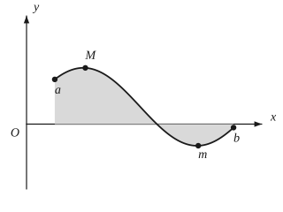
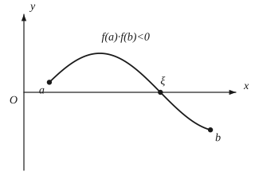
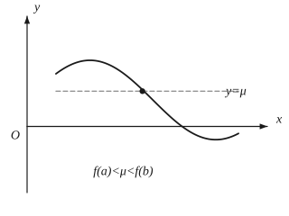

# 1.7 闭区间上连续函数的性质

前几节讨论的都是“一点附近”的性质：极限、连续、间断。这一节换成“整体”视角：如果一个函数在**闭区间**上**连续**，它能保证哪些全局结论？答案是四条：一定有最大值和最小值、一定有界、一定能取到两端函数值之间的任何数、如果两端异号则一定有零点。这四条性质看起来直观，却支撑着大量证明题，也是后面判断方程根的个数、证明不等式的基础。

## 一、最大值最小值定理

*图 1-14 闭区间上的最大值与最小值*

**定理 1.1（最值定理）** 如果函数 $f$ 在闭区间 $[a,b]$ 上连续，则 $f$ 在 $[a,b]$ 上一定能取得最大值 $M$ 和最小值 $m$。也就是说，存在 $\xi_1,\xi_2\in[a,b]$，使得
$$
f(\xi_1)=M,\qquad f(\xi_2)=m,
$$
且对一切 $x\in[a,b]$，都有 $m\le f(x)\le M$。

这里有两个条件不能少：**闭区间**和**连续**。

- $f(x)=\dfrac1x$ 在 $(0,1]$ 上连续，但无最大值（当 $x\to 0^+$ 时趋于无穷）。区间不是闭的。
- $f(x)=x$ 在 $(0,1)$ 上连续，但既无最大值也无最小值。区间不是闭的。
- $f(x)=\dfrac1x$ 在 $[0,1]$ 上（补充 $f(0)$ 任意）不连续，因为 $x=0$ 是无穷间断点。函数不连续。

直观上，闭区间“有边界、不漏点”，连续函数“不跳跃、不飞出去”，两者结合，函数值就被“关”在一个范围内，而且能碰到范围的上下沿。

注意，定理只保证最值**存在**，不告诉你怎样找到。实际求最值要靠第三章的导数方法。定理的价值在于：它让“最大值”“最小值”这两个词在证明中有意义。

## 二、有界性定理

**定理 1.2（有界性定理）** 如果 $f$ 在闭区间 $[a,b]$ 上连续，则 $f$ 在 $[a,b]$ 上有界，即存在 $M>0$，使对一切 $x\in[a,b]$，都有 $|f(x)|\le M$。

这其实是最值定理的直接推论：既然最大值 $M$ 和最小值 $m$ 都存在，取 $K=\max\{|M|,|m|\}$，就有 $|f(x)|\le K$。

反过来，开区间上连续函数不一定有界。$\dfrac1x$ 在 $(0,1]$ 上就是一个反例。所以“闭区间”不是装饰，而是定理成立的必要条件。

## 三、零点定理

*图 1-15 零点定理示意*

**定理 1.3（零点定理）** 如果 $f$ 在闭区间 $[a,b]$ 上连续，且
$$
f(a)f(b)<0,
$$
则在 $(a,b)$ 内至少存在一点 $\xi$，使得
$$
f(\xi)=0.
$$

几何上，函数图像从 $x$ 轴下方穿到上方（或反过来），中间必然穿过 $x$ 轴。因为连续意味着“不跳”，不能从负值“瞬间”跳到正值而不经过零。

这个定理的证明可以用二分法：把区间不断对分，每次保留“两端异号”的那一半，得到一个区间套，其长度趋于零；由连续性，区间套的公共点就是零点。考纲不要求写出这个证明，但“二分法”的思想值得知道，它是求方程近似解的基本方法。

**例 1.1** 证明方程 $x^3-3x+1=0$ 在 $(0,1)$ 内至少有一个根。

**证明** 令 $f(x)=x^3-3x+1$。$f$ 是多项式，在 $[0,1]$ 上连续。计算端点值：
$$
f(0)=1>0,\qquad f(1)=1-3+1=-1<0.
$$
所以 $f(0)f(1)<0$。由零点定理，存在 $\xi\in(0,1)$，使 $f(\xi)=0$，即方程在 $(0,1)$ 内至少有一个根。

**例 1.2** 证明方程 $x=\cos x$ 在 $\left(0,\dfrac{\pi}{2}\right)$ 内有且仅有一个根。

**证明** 令 $f(x)=x-\cos x$。$f$ 在 $\left[0,\dfrac{\pi}{2}\right]$ 上连续，且
$$
f(0)=0-1=-1<0,\qquad f\left(\frac{\pi}{2}\right)=\frac{\pi}{2}-0=\frac{\pi}{2}>0.
$$
由零点定理，至少有一个根。

再证唯一性。在 $\left(0,\dfrac{\pi}{2}\right)$ 内，$x$ 严格递增，$\cos x$ 严格递减，所以 $-\cos x$ 严格递增，从而 $f(x)=x-\cos x$ 严格递增。严格单调的函数最多有一个零点。因此根唯一。

注意“有且仅有一个”需要两步：存在性用零点定理，唯一性用单调性。只证存在，只能回答“至少一个”。

**例 1.3** 证明方程 $x\cdot 2^x=1$ 在 $(0,1)$ 内有根。

**证明** 令 $f(x)=x\cdot 2^x-1$。$f$ 在 $[0,1]$ 上连续，
$$
f(0)=-1<0,\qquad f(1)=2-1=1>0.
$$
由零点定理，存在 $\xi\in(0,1)$，使 $f(\xi)=0$。

## 四、介值定理

*图 1-16 介值定理示意*

**定理 1.4（介值定理）** 如果 $f$ 在 $[a,b]$ 上连续，$m$ 与 $M$ 分别是它在 $[a,b]$ 上的最小值与最大值，则对任意 $\mu\in[m,M]$，都存在 $\xi\in[a,b]$，使得
$$
f(\xi)=\mu.
$$

换句话说，连续函数在闭区间上的值域是闭区间 $[m,M]$，它不会“跳过”中间的任何值。

零点定理其实是介值定理的特例：取 $\mu=0$，只要 $0$ 介于 $m$ 与 $M$ 之间（特别地，$f(a)$ 与 $f(b)$ 异号就能保证这一点），就得到零点。

**例 1.4** 设 $f$ 在 $[0,1]$ 上连续，且对一切 $x\in[0,1]$，都有 $0\le f(x)\le 1$。证明存在 $\xi\in[0,1]$，使得 $f(\xi)=\xi$。

**证明** 令 $g(x)=f(x)-x$。$g$ 在 $[0,1]$ 上连续。计算
$$
g(0)=f(0)\ge 0,\qquad g(1)=f(1)-1\le 0.
$$
如果 $g(0)=0$，取 $\xi=0$；如果 $g(1)=0$，取 $\xi=1$。否则 $g(0)>0$ 且 $g(1)<0$，由零点定理，存在 $\xi\in(0,1)$，使 $g(\xi)=0$，即 $f(\xi)=\xi$。

这个结论叫**不动点定理**。它的证明模板很典型：把“$f(\xi)=\xi$”移项，构造 $g(x)=f(x)-x$，再对 $g$ 用零点定理。

**例 1.5** 设 $f$ 在 $[a,b]$ 上连续，证明存在 $\xi\in[a,b]$，使得
$$
f(\xi)=\frac{f(a)+f(b)}{2}.
$$

**证明** 设 $m,M$ 分别是 $f$ 在 $[a,b]$ 上的最小值与最大值。显然
$$
m\le\frac{f(a)+f(b)}{2}\le M.
$$
由介值定理，存在 $\xi\in[a,b]$，使 $f(\xi)=\dfrac{f(a)+f(b)}{2}$。

**例 1.6** 证明方程 $x^3=3x+1$ 在 $(1,2)$ 内有根。

**证明** 令 $f(x)=x^3-3x-1$。$f$ 在 $[1,2]$ 上连续，
$$
f(1)=1-3-1=-3<0,\qquad f(2)=8-6-1=1>0.
$$
由零点定理，存在 $\xi\in(1,2)$，使 $f(\xi)=0$。

## 五、用这些定理做证明题：一个固定模板

零点定理和介值定理的题目，大多可以按下面的模板走：

1. **移项，构造辅助函数**：把要证的等式写成 $F(x)=0$ 的形式。例如证 $f(\xi)=\xi$，令 $F(x)=f(x)-x$。
2. **验证连续性**：说明 $F$ 在闭区间 $[a,b]$ 上连续。多项式、初等函数在定义区间内连续，一般一句话带过。
3. **计算端点值**：算出 $F(a)$、$F(b)$，看是否异号；如果不异号，尝试找区间内另一点，或改用介值定理。
4. **下结论**：由零点定理得存在 $\xi\in(a,b)$，使 $F(\xi)=0$。
5. **若要唯一性**：再说明 $F$ 严格单调（可用导数，见第三章）。

这套模板的关键是第一步。辅助函数构造对了，后面就是例行公事。常见的构造有：

- 证 $f(\xi)=0$：直接令 $F=f$；
- 证 $f(\xi)=\xi$：令 $F=f(x)-x$；
- 证 $f(\xi)=c$：令 $F=f(x)-c$；
- 证 $f(\xi)=g(\xi)$：令 $F=f(x)-g(x)$；
- 证含 $\xi$ 与 $f(\xi)$ 的复杂等式：往往要先把 $\xi$ 换成 $x$，整理成 $F(x)=0$。

## 六、常见误区

1. **忽略“闭区间”。**  开区间上连续函数可能没有最值，也可能无界；零点定理的结论也会变弱。
2. **忽略“连续”。**  有间断点时，函数可以从负跳到正而不经过零。例如 $f(x)=\dfrac1x$ 在 $[-1,1]$ 上（$x=0$ 无定义）不连续，$f(-1)<0$、$f(1)>0$，但没有零点。
3. **把“存在”当成“唯一”。**  零点定理只保证至少一个；唯一性要另证。
4. **忘记说明 $\xi$ 的范围。**  零点定理给出 $\xi\in(a,b)$，介值定理给出 $\xi\in[a,b]$，写错范围会丢分。
5. **辅助函数构造后不验证连续性。**  这一步虽然简单，但必须写出来。

## 小结

1. 闭区间上连续函数一定取得最大值和最小值，从而一定有界。
2. 零点定理：两端异号 + 连续 ⇒ 区间内至少一个零点。
3. 介值定理：连续函数能取到最小值与最大值之间的一切值；零点是它的特例。
4. 证明题的模板是“构造辅助函数 → 验证连续 → 算端点值 → 下结论”；唯一性另用单调性。
5. 三个条件——闭区间、连续、端点异号——是零点定理的完整前提，缺一不可。

第一章到此结束。我们从函数出发，经过极限、无穷小、连续，终于把“变化”的语言准备好了。下一章进入导数：用极限刻画瞬时变化率，用一条直线去模仿曲线在一点附近的样子。
