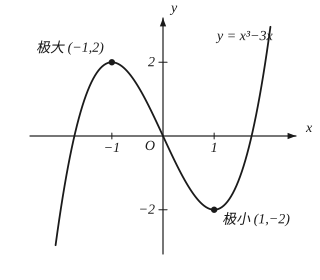
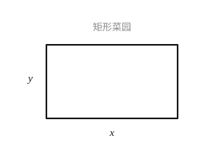

# 3.3 单调性、极值与最值

有了中值定理，导数符号与函数升降之间的关系就建立起来了：导数正，函数上升；导数负，函数下降。这条看似简单的结论，是导数应用中使用频率最高的工具。它不仅能画出函数的大致形状，还能求极值、最值，解决“用料最省”“面积最大”“利润最高”这类实际问题。

## 一、单调性的判定

**定理 3.1（单调性判定）** 设函数 $f$ 在区间 $I$ 上可导。

- 如果 $f'(x)>0$ 对一切 $x\in I$ 成立，则 $f$ 在 $I$ 上严格单调递增；
- 如果 $f'(x)<0$ 对一切 $x\in I$ 成立，则 $f$ 在 $I$ 上严格单调递减。

这是 3.1 节推论 3.2 的直接应用。证明只需对任意 $x_1<x_2$ 用拉格朗日中值定理：
$$
f(x_2)-f(x_1)=f'(\xi)(x_2-x_1),
$$
差值的符号由 $f'(\xi)$ 决定。

求单调区间的步骤是固定的：

1. 确定定义域；
2. 求 $f'(x)$；
3. 找出 $f'(x)=0$ 的点，以及 $f'(x)$ 不存在的点；
4. 用这些点把定义域分成若干区间，判断每个区间内 $f'$ 的符号；
5. 写出单调区间。

第 3 步容易被忽略：**导数不存在的点也可能是单调区间的分界点**。例如 $f(x)=x^{2/3}$ 在 $x=0$ 处导数不存在，但函数在 $(-\infty,0]$ 上递减、在 $[0,+\infty)$ 上递增，$x=0$ 是分界点。

**例 3.1** 求 $f(x)=x^3-3x$ 的单调区间。

**解** 定义域为 $\mathbb{R}$，
$$
f'(x)=3x^2-3=3(x-1)(x+1).
$$
令 $f'(x)=0$，得 $x=-1,1$。列表判断符号：

| 区间 | $(-\infty,-1)$ | $(-1,1)$ | $(1,+\infty)$ |
| --- | --- | --- | --- |
| $f'(x)$ | $+$ | $-$ | $+$ |
| $f(x)$ | 递增 | 递减 | 递增 |

所以 $f$ 在 $(-\infty,-1)$ 与 $(1,+\infty)$ 上单调递增，在 $(-1,1)$ 上单调递减。

**例 3.2** 求 $f(x)=x-\ln x$（$x>0$）的单调区间。

**解**
$$
f'(x)=1-\frac1x=\frac{x-1}{x}.
$$
当 $0<x<1$ 时，$f'(x)<0$；当 $x>1$ 时，$f'(x)>0$。所以 $f$ 在 $(0,1)$ 上递减，在 $(1,+\infty)$ 上递增。

**例 3.3** 求 $f(x)=xe^{-x}$ 的单调区间。

**解**
$$
f'(x)=e^{-x}-xe^{-x}=e^{-x}(1-x).
$$
因为 $e^{-x}>0$，所以 $f'$ 的符号由 $1-x$ 决定：$x<1$ 时 $f'>0$，$x>1$ 时 $f'<0$。所以 $f$ 在 $(-\infty,1)$ 上递增，在 $(1,+\infty)$ 上递减。

**例 3.4** 证明当 $x>0$ 时，
$$
x-\frac{x^2}{2}<\ln(1+x)<x.
$$

**证明** 先证右边。令
$$
f(x)=\ln(1+x)-x.
$$
则
$$
f'(x)=\frac{1}{1+x}-1=-\frac{x}{1+x}<0\qquad (x>0).
$$
所以 $f$ 在 $(0,+\infty)$ 上严格递减。又 $f(0)=0$，故当 $x>0$ 时 $f(x)<f(0)=0$，即 $\ln(1+x)<x$。

再证左边。令
$$
g(x)=\ln(1+x)-x+\frac{x^2}{2}.
$$
则
$$
g'(x)=\frac{1}{1+x}-1+x=\frac{1-(1+x)+x(1+x)}{1+x}=\frac{x^2}{1+x}>0\qquad (x>0).
$$
所以 $g$ 在 $(0,+\infty)$ 上严格递增。又 $g(0)=0$，故当 $x>0$ 时 $g(x)>0$，即
$$
\ln(1+x)>x-\frac{x^2}{2}.
$$
两个不等式合并，得证。

这个例子展示了用单调性证明不等式的标准套路：**移项构造 $F(x)$，证明 $F(0)=0$ 且 $F'$ 在区间上定号，从而 $F$ 定号。**  与 3.1 节用中值定理证不等式相比，单调性法更适合“端点值容易算、导数符号容易判断”的题。

## 二、极值：局部的最高点与最低点

*图 3-4 y = x³ − 3x 的极大点与极小点*

**定义 3.1（极值）** 设函数 $f$ 在点 $x_0$ 的某邻域内有定义。如果对该邻域内的一切 $x$，都有
$$
f(x)\le f(x_0),
$$
则称 $f$ 在 $x_0$ 处取得**极大值**，$x_0$ 称为**极大值点**；如果都有 $f(x)\ge f(x_0)$，则称取得**极小值**，$x_0$ 称为**极小值点**。极大值与极小值统称**极值**。

极值是**局部**概念，只比较 $x_0$ 附近的函数值；最值是**整体**概念，要比较整个区间上的函数值。一个函数可以有多个极大值，且某个极大值可能小于另一个极小值。

**必要条件。**  如果 $f$ 在 $x_0$ 处可导且取得极值，则 $f'(x_0)=0$（费马引理）。使 $f'(x)=0$ 的点称为**驻点**。但极值点也可能是导数不存在的点，例如 $f(x)=|x|$ 在 $x=0$ 处。驻点和导数不存在的点统称为**临界点**。极值点一定在临界点中，但临界点不一定是极值点。

**第一充分条件。**  设 $f$ 在 $x_0$ 处连续，在 $x_0$ 的某去心邻域内可导。

- 如果 $x<x_0$ 时 $f'(x)>0$，$x>x_0$ 时 $f'(x)<0$，则 $f$ 在 $x_0$ 处取得极大值；
- 如果 $x<x_0$ 时 $f'(x)<0$，$x>x_0$ 时 $f'(x)>0$，则取得极小值；
- 如果 $f'$ 在 $x_0$ 两侧不变号，则 $x_0$ 不是极值点。

一句话：**看导数是否变号，以及怎样变号。** 

**第二充分条件。**  设 $f'(x_0)=0$，$f''(x_0)$ 存在。

- 如果 $f''(x_0)<0$，则 $f$ 在 $x_0$ 处取得极大值；
- 如果 $f''(x_0)>0$，则取得极小值；
- 如果 $f''(x_0)=0$，则无法判断，要回到第一充分条件。

第二充分条件的几何解释：$f''(x_0)<0$ 说明曲线在 $x_0$ 附近是“凸”的（开口向下），驻点自然是峰顶；$f''(x_0)>0$ 说明开口向上，驻点是谷底。

**例 3.5** 求 $f(x)=x^3-3x$ 的极值。

**解** 由例 3.1，$f'(x)=3(x-1)(x+1)$，驻点为 $x=\pm1$。

当 $x<-1$ 时 $f'>0$，当 $-1<x<1$ 时 $f'<0$，导数在 $x=-1$ 处由正变负，所以 $x=-1$ 是极大值点，极大值为
$$
f(-1)=-1+3=2.
$$
当 $-1<x<1$ 时 $f'<0$，当 $x>1$ 时 $f'>0$，导数在 $x=1$ 处由负变正，所以 $x=1$ 是极小值点，极小值为
$$
f(1)=1-3=-2.
$$

**例 3.6** 求 $f(x)=x^{2/3}$ 的极值。

**解** 定义域为 $\mathbb{R}$，
$$
f'(x)=\frac{2}{3}x^{-1/3}=\frac{2}{3\sqrt[3]{x}}\qquad (x\neq 0).
$$
$f'$ 在 $x=0$ 处不存在，且没有驻点。当 $x<0$ 时 $f'<0$，当 $x>0$ 时 $f'>0$，导数在 $x=0$ 处由负变正，所以 $x=0$ 是极小值点，极小值为 $f(0)=0$。

这个例子说明：**极值点不一定满足 $f'=0$，也可能是导数不存在的点。**  求极值时，驻点和导数不存在的点都要检查。

**例 3.7** 讨论 $f(x)=x^3$ 在 $x=0$ 处的极值。

**解** $f'(x)=3x^2$，$f'(0)=0$。但在 $x=0$ 两侧，$f'(x)>0$ 恒成立，导数不变号，所以 $x=0$ 不是极值点。$f''(0)=0$，第二充分条件也失效。这说明“驻点”只是“可能极值点”，不是“一定极值点”。

**例 3.8** 讨论 $f(x)=x^4$ 在 $x=0$ 处的极值。

**解** $f'(x)=4x^3$，$f'(0)=0$；$f''(x)=12x^2$，$f''(0)=0$，第二充分条件失效。但 $f'(x)$ 在 $x=0$ 两侧由负变正，所以 $x=0$ 是极小值点，极小值为 $0$。这个例子说明：$f''(x_0)=0$ 时不能直接下结论，要回到第一充分条件。

## 三、最值：闭区间上的比较

求闭区间 $[a,b]$ 上连续函数的最值，步骤很简单：

1. 求 $f'(x)$，找出区间内的驻点和导数不存在的点；
2. 计算这些点以及端点 $a,b$ 处的函数值；
3. 比较大小，最大者为最大值，最小者为最小值。

**例 3.9** 求 $f(x)=x^3-3x$ 在 $[-2,3]$ 上的最大值与最小值。

**解** 由例 3.5，驻点为 $x=\pm1$，都在区间内。计算：
$$
f(-2)=-8+6=-2,\qquad f(-1)=2,\qquad f(1)=-2,\qquad f(3)=27-9=18.
$$
比较得最大值为 $18$（在 $x=3$ 处），最小值为 $-2$（在 $x=-2$ 和 $x=1$ 处）。

注意最小值同时在端点和内部驻点取得。** 最值可能在端点，也可能在内部临界点，两者都要比较。** 

**例 3.10** 求 $f(x)=x^2e^{-x}$ 在 $[0,4]$ 上的最值。

**解**
$$
f'(x)=2xe^{-x}-x^2e^{-x}=xe^{-x}(2-x).
$$
驻点为 $x=0,2$。计算：
$$
f(0)=0,\qquad f(2)=4e^{-2}=\frac{4}{e^2}\approx 0.541,\qquad f(4)=16e^{-4}=\frac{16}{e^4}\approx 0.293.
$$
最大值为 $\dfrac{4}{e^2}$（在 $x=2$ 处），最小值为 $0$（在 $x=0$ 处）。

**例 3.11（实际应用：最大面积）** 用长为 $L$ 的篱笆围一个矩形菜园，问长、宽各为多少时面积最大？

*图 3-5 矩形菜园篱笆（长 x、宽 y）*

**解** 设矩形的长为 $x$，宽为 $y$，则
$$
2(x+y)=L,\qquad y=\frac L2-x.
$$
面积
$$
S(x)=x\left(\frac L2-x\right)=\frac L2x-x^2,\qquad 0<x<\frac L2.
$$
求导：
$$
S'(x)=\frac L2-2x.
$$
令 $S'=0$，得 $x=\dfrac L4$，此时 $y=\dfrac L4$。$S''(x)=-2<0$，所以是极大值点，也是最大值点。最大面积为
$$
S\left(\frac L4\right)=\frac{L^2}{16}.
$$
当长与宽相等（正方形）时面积最大。

**例 3.12（实际应用：最省材料）** 要制造一个体积为 $V$ 的圆柱形罐头，问底面半径 $r$ 与高 $h$ 各为多少时，表面积最小？

**解** 体积
$$
V=\pi r^2h,\qquad h=\frac{V}{\pi r^2}.
$$
表面积（含上下底）
$$
S=2\pi r^2+2\pi rh=2\pi r^2+\frac{2V}{r},\qquad r>0.
$$
求导：
$$
S'(r)=4\pi r-\frac{2V}{r^2}.
$$
令 $S'=0$，得
$$
4\pi r^3=2V,\qquad r^3=\frac{V}{2\pi}.
$$
由 $V=\pi r^2h$，得
$$
r^3=\frac{\pi r^2h}{2\pi}=\frac{r^2h}{2},
$$
所以 $h=2r$。此时
$$
S''(r)=4\pi+\frac{4V}{r^3}>0,
$$
是极小值点，也是最小值点。** 当高等于底面直径时，表面积最小。** 

## 四、极值与最值的关系

- 极值是局部概念，最值是整体概念；
- 闭区间上的最值只可能在端点或内部临界点取得；
- 如果函数在区间内只有一个极值点，且该极值是极大（小）值，那么它往往就是最大（小）值（但严格说还要看端点或无穷远的行为）；
- 实际问题中，如果根据题意最值一定存在，且驻点唯一，那么该驻点就是最值点，不必再判别。

## 五、常见误区

1. **认为 $f'(x_0)=0$ 就一定是极值。**  $x^3$ 在 $0$ 处是反例。
2. **忽略导数不存在的点。**  $x^{2/3}$、$|x|$ 的极值点都在导数不存在处。
3. **把极值当成最值。**  极值只在局部比较，最值要比较整个区间。
4. **求闭区间最值时漏掉端点。**  端点常常就是最值点。
5. **实际问题忘记定义域。**  长、宽、半径都必须为正，定义域会限制驻点是否可取。
6. **第二充分条件失效时硬下结论。**  $f''(x_0)=0$ 时要用第一充分条件。

## 小结

1. 导数正负决定单调性；求单调区间要列出驻点和导数不存在的点，分区间判号。
2. 极值的必要条件是临界点（$f'=0$ 或 $f'$ 不存在），充分条件看导数是否变号；第二充分条件在 $f''\neq 0$ 时更方便。
3. 闭区间最值：比较内部临界点与端点的函数值。
4. 实际问题：建立目标函数，确定定义域，求驻点，结合题意判断最值。
5. 用单调性证明不等式的套路是“移项构造 $F$，算 $F(0)$，判 $F'$ 的符号”。

下一节把二阶导数用起来：判断曲线的凹凸性、找拐点、求渐近线，最后给出函数作图的完整步骤。
