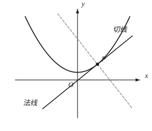

# 2.1 导数：瞬时变化率与局部线性化

第一章准备了极限这件工具，现在到了用它的时候。导数要回答两个看似不同、其实同构的问题：物体在某一瞬间的速度是多少？曲线在某一点的切线斜率是多少？这两个问题的数学结构完全一样——都是“先算平均，再让时间间隔或距离间隔趋于零”。理解了这一点，导数就不是一串公式，而是一种**把局部变化线性化**的方法。

## 一、从平均到瞬时

**瞬时速度。**  物体做直线运动，位移 $s=s(t)$。从 $t_0$ 到 $t_0+\Delta t$，平均速度是
$$
\bar v=\frac{s(t_0+\Delta t)-s(t_0)}{\Delta t}.
$$
平均速度只能描述一段时间内的整体快慢，不能描述“某一瞬间”的快慢。要让“瞬间”有意义，就让 $\Delta t\to 0$，把平均速度的极限定义为瞬时速度：
$$
v(t_0)=\lim_{\Delta t\to 0}\frac{s(t_0+\Delta t)-s(t_0)}{\Delta t}.
$$

**切线斜率。**  曲线 $y=f(x)$ 上取定点 $P(x_0,f(x_0))$ 和动点 $Q(x_0+\Delta x,f(x_0+\Delta x))$。割线 $PQ$ 的斜率为
$$
k_{PQ}=\frac{f(x_0+\Delta x)-f(x_0)}{\Delta x}.
$$
当 $Q$ 沿曲线趋于 $P$ 时，割线趋于一条极限位置的直线，称为曲线在 $P$ 点的切线。切线的斜率就是
$$
k=\lim_{\Delta x\to 0}\frac{f(x_0+\Delta x)-f(x_0)}{\Delta x}.
$$

两个问题的表达式一模一样，都是**函数增量与自变量增量之比，在增量趋于零时的极限**。把这个共同的数学结构抽象出来，就是导数。

## 二、导数的定义

**定义 2.1（导数）** 设函数 $y=f(x)$ 在点 $x_0$ 的某个邻域内有定义。如果极限
$$
\lim_{\Delta x\to 0}\frac{f(x_0+\Delta x)-f(x_0)}{\Delta x}
$$
存在，则称 $f$ 在点 $x_0$ 处**可导**，并称这个极限为 $f$ 在 $x_0$ 处的**导数**，记作
$$
f'(x_0),\qquad y'|_{x=x_0},\qquad \left.\frac{\mathrm dy}{\mathrm dx}\right|_{x=x_0}.
$$

等价地，令 $x=x_0+\Delta x$，可以写成
$$
f'(x_0)=\lim_{x\to x_0}\frac{f(x)-f(x_0)}{x-x_0}.
$$
这两种写法在解题中都很常用：前者适合“给增量”的题，后者适合“给两点”的题。

如果只让 $\Delta x\to 0^-$，得到**左导数** $f'_-(x_0)$；只让 $\Delta x\to 0^+$，得到**右导数** $f'_+(x_0)$。与极限的情形一样：
$$
f'(x_0)\ \text{存在}\quad\Longleftrightarrow\quad f'_-(x_0)=f'_+(x_0).
$$
这里左右导数都要求存在且为有限数；若两侧都趋于 $+\infty$，不能据此说导数存在。
分段函数在分界点处是否可导，就是比较左右导数。

**例 2.1** 用定义求 $f(x)=x^2$ 在 $x_0$ 处的导数。

**解**
$$
f'(x_0)=\lim_{\Delta x\to 0}\frac{(x_0+\Delta x)^2-x_0^2}{\Delta x}
=\lim_{\Delta x\to 0}\frac{2x_0\Delta x+(\Delta x)^2}{\Delta x}
=\lim_{\Delta x\to 0}(2x_0+\Delta x)=2x_0.
$$
所以 $f'(x_0)=2x_0$，即 $(x^2)'=2x$。

**例 2.2** 用定义求 $f(x)=\sqrt{x}$ 在 $x_0>0$ 处的导数。

**解**
$$
f'(x_0)=\lim_{\Delta x\to 0}\frac{\sqrt{x_0+\Delta x}-\sqrt{x_0}}{\Delta x}.
$$
分子有理化：
$$
\frac{\sqrt{x_0+\Delta x}-\sqrt{x_0}}{\Delta x}
=\frac{(x_0+\Delta x)-x_0}{\Delta x\left(\sqrt{x_0+\Delta x}+\sqrt{x_0}\right)}
=\frac{1}{\sqrt{x_0+\Delta x}+\sqrt{x_0}}.
$$
令 $\Delta x\to 0$，得
$$
f'(x_0)=\frac{1}{2\sqrt{x_0}}.
$$

**例 2.3** 讨论 $f(x)=|x|$ 在 $x=0$ 处的可导性。

**解** 左导数：
$$
f'_-(0)=\lim_{x\to 0^-}\frac{|x|-0}{x-0}=\lim_{x\to 0^-}\frac{-x}{x}=-1.
$$
右导数：
$$
f'_+(0)=\lim_{x\to 0^+}\frac{|x|-0}{x-0}=\lim_{x\to 0^+}\frac{x}{x}=1.
$$
左右导数不相等，所以 $f$ 在 $x=0$ 处不可导。

**例 2.4** 设
$$
f(x)=\begin{cases}
x^2\sin\dfrac1x, & x\neq 0,\\
0, & x=0.
\end{cases}
$$
讨论 $f$ 在 $x=0$ 处的可导性。

**解** 用定义：
$$
f'(0)=\lim_{x\to 0}\frac{x^2\sin\dfrac1x-0}{x-0}=\lim_{x\to 0}x\sin\frac1x=0,
$$
这里用了“有界函数乘无穷小”。所以 $f$ 在 $x=0$ 处可导，且 $f'(0)=0$。

这个例子说明：**函数在一点可导，不要求导数在该点连续**。事实上，当 $x\neq 0$ 时，
$$
f'(x)=2x\sin\frac1x-\cos\frac1x,
$$
当 $x\to 0$ 时，第一项趋于 $0$，第二项在 $-1$ 与 $1$ 之间振荡，所以 $\lim\limits_{x\to 0}f'(x)$ 不存在。导函数在 $x=0$ 处不连续，但 $f'(0)$ 仍然存在。这类例子在选择题中偶尔出现，记住“可导”与“导函数连续”是两回事。

## 三、可导与连续：单向的门

**定理 2.1（可导必连续）** 如果 $f$ 在 $x_0$ 处可导，则 $f$ 在 $x_0$ 处连续。

**证明** 由可导的定义，
$$
\lim_{\Delta x\to 0}\frac{\Delta y}{\Delta x}=f'(x_0).
$$
于是
$$
\Delta y=\frac{\Delta y}{\Delta x}\cdot\Delta x\to f'(x_0)\cdot 0=0\qquad(\Delta x\to 0).
$$
这正是连续的定义（自变量增量趋于零时函数增量趋于零）。所以 $f$ 在 $x_0$ 处连续。

逆命题不成立。$y=|x|$ 在 $x=0$ 处连续，但左右导数分别为 $-1$ 和 $1$，不可导。几何上，连续只要求“图像不断”，可导还要求“图像光滑、有非垂直的切线”。尖点、折点、垂直切线，都是“连续但不可导”的典型。

**例 2.5** 讨论 $f(x)=\sqrt[3]{x}$ 在 $x=0$ 处的可导性。

**解**
$$
\frac{f(0+\Delta x)-f(0)}{\Delta x}=\frac{\sqrt[3]{\Delta x}}{\Delta x}=\frac{1}{(\Delta x)^{2/3}}\to+\infty.
$$
差商的极限不是有限数，所以 $f$ 在 $x=0$ 处不可导。但 $f$ 在 $x=0$ 处连续，图像在该点的切线是垂直的。

**例 2.6** 讨论
$$
f(x)=\begin{cases}
x\sin\dfrac1x, & x\neq 0,\\
0, & x=0
\end{cases}
$$
在 $x=0$ 处的连续性与可导性。

**解** 连续性：$|f(x)|\le |x|\to 0$，且 $f(0)=0$，所以连续。

可导性：
$$
\frac{f(x)-f(0)}{x-0}=\sin\frac1x,
$$
当 $x\to 0$ 时极限不存在（振荡），所以不可导。

这个例子与例 2.4 只差一个因子 $x$：$x\sin\dfrac1x$ 连续但不可导，$x^2\sin\dfrac1x$ 则可导。差商的“阶”决定了可导性，这也是考试中常见的对比。

## 四、导数的几何意义：切线与法线

*图 2-2 切点处的切线与法线*

$f'(x_0)$ 就是曲线 $y=f(x)$ 在点 $(x_0,f(x_0))$ 处切线的斜率。因此切线方程为
$$
y-f(x_0)=f'(x_0)(x-x_0).
$$
法线与切线垂直，斜率为 $-\dfrac{1}{f'(x_0)}$（当 $f'(x_0)\neq 0$），方程为
$$
y-f(x_0)=-\frac{1}{f'(x_0)}(x-x_0).
$$
当 $f'(x_0)=0$ 时，切线水平，法线竖直，方程为 $x=x_0$。

**例 2.7** 求曲线 $y=x^2$ 在点 $(1,1)$ 处的切线方程与法线方程。

**解** $y'=2x$，在 $x=1$ 处 $y'=2$。切线：
$$
y-1=2(x-1),\qquad\text{即}\quad y=2x-1.
$$
法线斜率为 $-\dfrac12$：
$$
y-1=-\frac12(x-1),\qquad\text{即}\quad x+2y-3=0.
$$

**例 2.8** 求曲线 $y=\ln x$ 在 $x=e$ 处的切线方程。

**解** $y'=\dfrac1x$，在 $x=e$ 处 $y'=\dfrac1e$，点为 $(e,1)$。切线：
$$
y-1=\frac1e(x-e),\qquad\text{即}\quad y=\frac{x}{e}.
$$
这条切线恰好过原点，是 $y=\ln x$ 的一个漂亮性质。

**例 2.9** 求曲线 $y=x^3$ 上切线平行于直线 $y=3x+1$ 的点。

**解** 切线平行于 $y=3x+1$，意味着斜率为 $3$。由 $y'=3x^2=3$，得 $x=\pm 1$。对应点为 $(1,1)$ 与 $(-1,-1)$。

## 五、导函数

如果 $f$ 在区间 $I$ 内每一点都可导，则对每个 $x\in I$，都有一个导数值 $f'(x)$ 与之对应，这样就得到一个新的函数，称为 $f$ 的**导函数**，简称导数，记作
$$
f'(x),\qquad y',\qquad \frac{\mathrm dy}{\mathrm dx}.
$$
注意区分 $f'(x_0)$ 与 $f'(x)$：前者是一个数，后者是一个函数。求 $f'(x_0)$ 时，可以先求导函数再代入，也可以直接用定义。

**例 2.10** 用定义求 $f(x)=x^3$ 的导函数。

**解**
$$
f'(x)=\lim_{\Delta x\to 0}\frac{(x+\Delta x)^3-x^3}{\Delta x}
=\lim_{\Delta x\to 0}\frac{3x^2\Delta x+3x(\Delta x)^2+(\Delta x)^3}{\Delta x}
=\lim_{\Delta x\to 0}\left(3x^2+3x\Delta x+(\Delta x)^2\right)=3x^2.
$$

## 六、局部线性化：导数的本质

把可导的定义改写一下。由
$$
\lim_{\Delta x\to 0}\frac{\Delta y}{\Delta x}=f'(x_0)
$$
可得
$$
\Delta y=f'(x_0)\Delta x+o(\Delta x).
$$
也就是说，当 $\Delta x$ 很小时，
$$
f(x_0+\Delta x)\approx f(x_0)+f'(x_0)\Delta x.
$$
右边是 $\Delta x$ 的一次函数，它的图像就是切线。** 导数给出的是曲线在一点附近最好的线性近似**：在众多过该点的直线中，切线在局部“贴得最紧”。

这就是“局部线性化”的含义。它解释了为什么导数能用来做近似计算。例如，取 $f(x)=\sqrt{x}$，$x_0=1$，$\Delta x=0.02$：
$$
\sqrt{1.02}\approx \sqrt1+\frac{1}{2\sqrt1}\cdot 0.02=1.01.
$$
真实值约为 $1.00995$，误差不到 $5\times 10^{-5}$。第二章第五节会把这件事写成“微分”，并给出更系统的近似公式。

## 七、常见误区

1. **把导数当成 $\dfrac{\Delta y}{\Delta x}$。**  导数是差商的极限，不是差商本身。
2. **认为连续一定可导。**  $|x|$、$\sqrt[3]{x}$、$x\sin\dfrac1x$ 都是反例。
3. **认为切线只与曲线交于一点。**  切线是局部概念，可能与其他部分相交多次；例如 $y=\sin x$ 在原点处的切线 $y=x$ 会与曲线反复相交。
4. **在垂直切线处写斜率。**  $x=0$ 处 $\sqrt[3]{x}$ 的切线是 $x=0$，斜率不存在，不能写成 $y=kx+b$。
5. **求分段点导数时只看一侧。**  必须分别算左右导数，再判断是否相等。
6. **混淆“可导”与“导函数连续”。**  如例 2.4，$f'(0)$ 存在，但 $\lim\limits_{x\to 0}f'(x)$ 不存在。

## 小结

1. 导数 = 差商的极限 = 瞬时变化率 = 切线斜率。
2. 可导必连续，连续不一定可导；判断分段点可导性要看左右导数。
3. 切线方程 $y-f(x_0)=f'(x_0)(x-x_0)$；法线斜率为 $-\dfrac{1}{f'(x_0)}$。
4. 导数的本质是局部线性化：$\Delta y=f'(x_0)\Delta x+o(\Delta x)$，从而 $f(x)\approx f(x_0)+f'(x_0)(x-x_0)$。
5. 导函数是一个函数，$f'(x_0)$ 是它在 $x_0$ 处的值。

下一节不再用定义硬算，而是建立一套求导法则：四则运算、复合函数、反函数。掌握它们之后，绝大多数初等函数的导数都能在几行内算出来。
