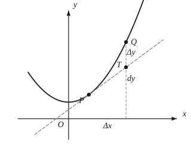

# 2.5 微分与一阶形式不变性

导数回答“变化有多快”，微分回答“变化了多少”。这两个问题看起来只差一层，实际上侧重点不同：导数是函数在一点的性质，微分是增量的**线性主部**。理解了微分，才能理解为什么 $\mathrm dy=f'(x)\mathrm dx$ 可以像分数一样“拆开”，也才能理解第四章换元积分中“凑微分”的合法性。

## 一、从增量到微分

设 $y=f(x)$ 在点 $x$ 处可导。自变量有一个小增量 $\Delta x$，函数增量为
$$
\Delta y=f(x+\Delta x)-f(x).
$$
由可导的定义，
$$
\lim_{\Delta x\to 0}\frac{\Delta y}{\Delta x}=f'(x),
$$
所以
$$
\Delta y=f'(x)\Delta x+o(\Delta x)\qquad(\Delta x\to 0).
$$
右边第一项是 $\Delta x$ 的线性函数，第二项是比 $\Delta x$ 高阶的无穷小。当 $\Delta x$ 很小时，第一项是 $\Delta y$ 的“主要部分”，第二项可以忽略。

**定义 2.1（微分）** 如果函数 $y=f(x)$ 在点 $x$ 处的增量可以写成
$$
\Delta y=A\Delta x+o(\Delta x),
$$
其中 $A$ 与 $\Delta x$ 无关，则称 $f$ 在点 $x$ 处**可微**，并称 $A\Delta x$ 为 $f$ 在点 $x$ 处的**微分**，记作
$$
\mathrm dy=A\Delta x.
$$

**定理 2.1（可微与可导等价）** 一元函数 $f$ 在点 $x$ 处可微的充要条件是 $f$ 在点 $x$ 处可导，且
$$
A=f'(x),\qquad \mathrm dy=f'(x)\Delta x.
$$

**证明** 若 $f$ 可微，则 $\Delta y=A\Delta x+o(\Delta x)$，两边除以 $\Delta x$ 并令 $\Delta x\to 0$，得 $\dfrac{\Delta y}{\Delta x}\to A$，所以 $f'(x)=A$，可导。

反之，若 $f$ 可导，则
$$
\frac{\Delta y}{\Delta x}=f'(x)+\alpha,\qquad \alpha\to 0,
$$
于是 $\Delta y=f'(x)\Delta x+\alpha\Delta x$，而 $\alpha\Delta x=o(\Delta x)$，所以 $f$ 可微，且 $A=f'(x)$。

由于自变量 $x$ 的微分就是它的增量，即 $\mathrm dx=\Delta x$，所以微分的常用写法是
$$
\mathrm dy=f'(x)\mathrm dx.
$$
这个式子把导数写成两个微分之比：
$$
f'(x)=\frac{\mathrm dy}{\mathrm dx}.
$$
Leibniz 当年正是这样理解导数的：它是两个“无穷小增量”的商。今天我们不用无穷小，而是用极限定义导数，但这个记号仍然保留了“商”的直观，也方便记忆链式法则。

**例 2.1** 设 $y=x^2$，求 $\mathrm dy$，并计算 $x=1$、$\Delta x=0.01$ 时的 $\mathrm dy$ 与 $\Delta y$。

**解** $\mathrm dy=2x\,\mathrm dx$。当 $x=1$、$\mathrm dx=0.01$ 时，
$$
\mathrm dy=2\cdot 1\cdot 0.01=0.02.
$$
而
$$
\Delta y=(1.01)^2-1^2=1.0201-1=0.0201.
$$
两者相差 $0.0001$，正好是 $o(\Delta x)$ 的部分。

**例 2.2** 设 $y=\sin x$，求 $\mathrm dy$。

**解** $\mathrm dy=\cos x\,\mathrm dx$。

## 二、几何意义：切线上的增量

*图 2-3 函数增量 Δy 与切线增量 dy*

在曲线 $y=f(x)$ 上取点 $P(x,f(x))$，作切线。当自变量增加 $\Delta x$ 时：

- 曲线上的点移动到 $Q(x+\Delta x,f(x+\Delta x))$，对应的函数增量是 $\Delta y$；
- 切线上的点移动到 $T$，对应的纵坐标增量是 $\mathrm dy=f'(x)\Delta x$。

所以，**$\mathrm dy$ 是切线的纵坐标增量，$\Delta y$ 是曲线的纵坐标增量**。两者之差 $\Delta y-\mathrm dy=o(\Delta x)$，这就是“以直代曲”的误差：当 $\Delta x$ 很小时，切线可以很好地近似曲线。

这也给出了微分的一个直观解释：**微分是用切线代替曲线时，函数值的改变量**。导数是切线的斜率，微分是沿切线走一小步的高度变化。

## 三、微分公式与运算法则

由 $\mathrm dy=f'(x)\mathrm dx$，基本导数表可以直接翻译成微分表：

$$
\mathrm d(C)=0,\qquad \mathrm d(x^\alpha)=\alpha x^{\alpha-1}\mathrm dx,
$$
$$
\mathrm d(e^x)=e^x\mathrm dx,\qquad \mathrm d(a^x)=a^x\ln a\,\mathrm dx,
$$
$$
\mathrm d(\ln x)=\frac{\mathrm dx}{x},\qquad \mathrm d(\sin x)=\cos x\,\mathrm dx,\qquad \mathrm d(\cos x)=-\sin x\,\mathrm dx,
$$
$$
\mathrm d(\tan x)=\sec^2x\,\mathrm dx,\qquad \mathrm d(\arcsin x)=\frac{\mathrm dx}{\sqrt{1-x^2}},\qquad \mathrm d(\arctan x)=\frac{\mathrm dx}{1+x^2}.
$$

微分也满足线性、乘积、商的法则：
$$
\mathrm d(u\pm v)=\mathrm du\pm\mathrm dv,
$$
$$
\mathrm d(uv)=u\,\mathrm dv+v\,\mathrm du,
$$
$$
\mathrm d\left(\frac uv\right)=\frac{v\,\mathrm du-u\,\mathrm dv}{v^2}\qquad (v\neq 0).
$$

**例 2.3** 设 $y=x^2\sin x$，求 $\mathrm dy$。

**解**
$$
\mathrm dy=\mathrm d(x^2\sin x)=\sin x\,\mathrm d(x^2)+x^2\,\mathrm d(\sin x)
=2x\sin x\,\mathrm dx+x^2\cos x\,\mathrm dx,
$$
即
$$
\mathrm dy=x(2\sin x+x\cos x)\mathrm dx.
$$

**例 2.4** 设 $y=\ln(1+x^2)$，求 $\mathrm dy$。

**解**
$$
\mathrm dy=\frac{1}{1+x^2}\cdot 2x\,\mathrm dx=\frac{2x}{1+x^2}\mathrm dx.
$$

## 四、一阶微分形式不变性

这是微分最重要的性质。设 $y=f(u)$，无论 $u$ 是自变量还是另一个变量的函数，一阶微分的形式都是
$$
\mathrm dy=f'(u)\mathrm du.
$$

**证明** 如果 $u$ 是自变量，这就是微分的定义。如果 $u=\varphi(x)$ 是 $x$ 的函数，则 $y=f[\varphi(x)]$，由链式法则，
$$
\frac{\mathrm dy}{\mathrm dx}=f'(u)\varphi'(x),
$$
所以
$$
\mathrm dy=f'(u)\varphi'(x)\mathrm dx=f'(u)\mathrm du,
$$
因为 $\mathrm du=\varphi'(x)\mathrm dx$。两种情形下，微分的形式完全一样。

这个性质称为**一阶微分形式不变性**。它的意义是：**微分公式不依赖于 $u$ 是“自变量”还是“中间变量”**。例如
$$
\mathrm d(\sin u)=\cos u\,\mathrm du
$$
对任何可微的 $u$ 都成立，不必关心 $u$ 背后还有没有别的变量。

这条性质在第四章换元积分中会反复使用。例如
$$
\int \cos(2x)\,\mathrm dx=\frac12\int\cos(2x)\,\mathrm d(2x)=\frac12\sin(2x)+C,
$$
这里的 $\mathrm d(2x)=2\mathrm dx$ 就是微分形式不变性的直接应用。没有它，“凑微分”就缺少理论依据。

**例 2.5** 利用微分形式不变性，求 $\mathrm d\left(\sqrt{1+x^2}\right)$。

**解** 设 $u=1+x^2$，则
$$
\mathrm d\left(\sqrt u\right)=\frac{1}{2\sqrt u}\mathrm du
=\frac{1}{2\sqrt{1+x^2}}\cdot 2x\,\mathrm dx
=\frac{x}{\sqrt{1+x^2}}\mathrm dx.
$$

**例 2.6** 填空：$\mathrm d(\quad)=x\,\mathrm dx$。

**解** 因为 $\mathrm d(x^2)=2x\,\mathrm dx$，所以
$$
x\,\mathrm dx=\frac12\mathrm d(x^2)=\mathrm d\left(\frac{x^2}{2}\right).
$$
因此填 $\dfrac{x^2}{2}+C$（微分中常数项可以任意）。

## 五、近似计算与误差估计

由 $\Delta y\approx\mathrm dy$，得到近似公式
$$
f(x_0+\Delta x)\approx f(x_0)+f'(x_0)\Delta x.
$$
当 $|\Delta x|$ 很小时，这个公式很好用。

**例 2.7** 计算 $\sqrt{1.02}$ 的近似值。

**解** 取 $f(x)=\sqrt x$，$x_0=1$，$\Delta x=0.02$。$f'(x)=\dfrac{1}{2\sqrt x}$，$f'(1)=\dfrac12$。所以
$$
\sqrt{1.02}\approx 1+\frac12\cdot 0.02=1.01.
$$

**例 2.8** 计算 $\ln 1.01$ 的近似值。

**解** 取 $f(x)=\ln x$，$x_0=1$，$\Delta x=0.01$，$f'(1)=1$：
$$
\ln 1.01\approx 0+1\cdot 0.01=0.01.
$$

**例 2.9** 计算 $\sin 1^\circ$ 的近似值。

**解** 必须先把角度化为弧度：$1^\circ=\dfrac{\pi}{180}\approx 0.01745$。取 $f(x)=\sin x$，$x_0=0$，$\Delta x=\dfrac{\pi}{180}$，$f'(0)=1$：
$$
\sin 1^\circ\approx 0+1\cdot\frac{\pi}{180}\approx 0.01745.
$$

**例 2.10** 计算 $(1.01)^{10}$ 的近似值。

**解** 取 $f(x)=x^{10}$，$x_0=1$，$\Delta x=0.01$，$f'(1)=10$：
$$
(1.01)^{10}\approx 1+10\cdot 0.01=1.1.
$$

**误差估计。** 如果测量 $x$ 时有绝对误差 $|\Delta x|$，则 $y=f(x)$ 的绝对误差约为
$$
|\Delta y|\approx|f'(x)||\Delta x|,
$$
相对误差约为
$$
\left|\frac{\Delta y}{y}\right|\approx\left|\frac{f'(x)}{f(x)}\right||\Delta x|.
$$

**例 2.11** 测得圆半径 $r=10\text{ cm}$，测量误差不超过 $0.05\text{ cm}$。估计圆面积 $A=\pi r^2$ 的绝对误差与相对误差。

**解**
$$
\mathrm dA=2\pi r\,\mathrm dr.
$$
取 $r=10$，$|\mathrm dr|=0.05$，
$$
|\Delta A|\approx 2\pi\cdot 10\cdot 0.05=\pi\approx 3.14\text{ cm}^2.
$$
相对误差
$$
\left|\frac{\Delta A}{A}\right|\approx\frac{2\pi r\,\mathrm dr}{\pi r^2}
=2\frac{|\mathrm dr|}{r}=2\cdot\frac{0.05}{10}=1\%.
$$

## 六、微分与导数的区别

| 项目 | 导数 | 微分 |
| --- | --- | --- |
| 本质 | 变化率 | 增量的线性主部 |
| 记号 | $f'(x)$，$\dfrac{\mathrm dy}{\mathrm dx}$ | $\mathrm dy=f'(x)\mathrm dx$ |
| 几何 | 切线斜率 | 切线上的纵坐标增量 |
| 取值 | 一个数（给定 $x$ 时） | 一个与 $\mathrm dx$ 有关的量 |
| 用途 | 判断单调、极值、凹凸 | 近似计算、误差估计、凑微分 |

导数与微分通过 $\mathrm dy=f'(x)\mathrm dx$ 联系。可以把导数看成“微分之比”，但要注意：这个“比”是两个微分之比，不是两个普通数的比。

## 七、常见误区

1. **把 $\mathrm dy$ 写成 $f'(x)$。** 微分是 $f'(x)\mathrm dx$，少写 $\mathrm dx$ 就变成了导数。
2. **认为 $\mathrm dx=\Delta x$ 对任何变量都成立。** 只有当 $x$ 是自变量时才有 $\mathrm dx=\Delta x$；对因变量 $y$，一般 $\mathrm dy\neq\Delta y$。
3. **把一阶形式不变性推广到二阶。** 二阶微分没有这样的简单形式，$\mathrm d^2y=f''(u)\mathrm du^2$ 只在 $u$ 是自变量时成立；$u$ 是中间变量时还要加一项 $f'(u)\mathrm d^2u$。考纲只要求一阶，不要越界。
4. **近似计算时 $\Delta x$ 太大。** 近似公式只在 $|\Delta x|$ 很小时有效；$\Delta x$ 越大，误差越大。
5. **角度不化弧度。** $\sin 1^\circ\approx 0.01745$，不是 $\sin 1\approx 0.841$；近似公式中的 $x$ 必须是弧度。

## 小结

1. 微分是函数增量的线性主部：$\Delta y=f'(x)\Delta x+o(\Delta x)$，记 $\mathrm dy=f'(x)\mathrm dx$。
2. 一元函数可微与可导等价，且 $A=f'(x)$。
3. 几何上，$\mathrm dy$ 是切线上的纵坐标增量，$\Delta y$ 是曲线上的纵坐标增量，两者相差高阶无穷小。
4. 一阶微分形式不变性：无论 $u$ 是自变量还是中间变量，$\mathrm dy=f'(u)\mathrm du$ 都成立。这是凑微分的理论依据。
5. 近似公式 $f(x_0+\Delta x)\approx f(x_0)+f'(x_0)\Delta x$ 可用于计算和误差估计，前提是 $|\Delta x|$ 足够小、角度用弧度。

第二章到此结束。我们有了导数、求导法则、高阶导数和微分这几件工具，下一章开始用它们解决实际问题：判断单调性、求极值和最值、判断凹凸性、画函数图像，以及用中值定理和洛必达法则处理极限与证明。
