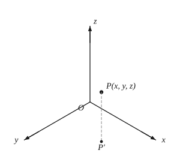
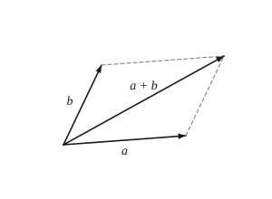

# 5.1 空间直角坐标系与向量

前四章的函数都生活在一维数轴上：一个自变量 $x$，一个因变量 $y$。空间解析几何把舞台扩展到三维：点有三个坐标，直线和平面要用方程描述，而描述它们最方便的语言是向量。这一节先建立坐标系，再讲向量的加法、数乘与模；最后补充一点数量积，它是判断垂直关系的利器（考纲只要求加法与数乘，数量积作为拓展）。

## 一、空间直角坐标系

*图 5-1 空间直角坐标系*

在空间中取一点 $O$ 作为原点，作三条两两垂直的数轴：$x$ 轴、$y$ 轴、$z$ 轴。通常规定 $x,y,z$ 轴的正方向满足**右手规则**：右手四指从 $x$ 轴正向弯向 $y$ 轴正向，拇指指向 $z$ 轴正向。这样的三条轴组成**空间直角坐标系** $Oxyz$。

三条坐标轴两两确定三个坐标平面：$xOy$ 平面、$yOz$ 平面、$zOx$ 平面。它们把空间分成八个卦限。

对空间中任意一点 $P$，过 $P$ 分别作三个坐标轴的垂直平面，它们与 $x,y,z$ 轴的交点坐标分别为 $x,y,z$，则称 $P$ 的坐标为 $(x,y,z)$。反过来，给定三个数，就能确定唯一的点。

**两点间的距离。** 设 $P_1(x_1,y_1,z_1)$，$P_2(x_2,y_2,z_2)$，则
$$
|P_1P_2|=\sqrt{(x_2-x_1)^2+(y_2-y_1)^2+(z_2-z_1)^2}.
$$
这是平面距离公式的自然推广：三次勾股定理。

**例 5.1** 求点 $A(1,2,3)$ 与 $B(2,-1,4)$ 之间的距离。

**解**
$$
|AB|=\sqrt{(2-1)^2+(-1-2)^2+(4-3)^2}
=\sqrt{1+9+1}=\sqrt{11}.
$$

**例 5.2** 写出到原点距离为 $R$ 的点的集合。

**解** 设点为 $(x,y,z)$，则
$$
\sqrt{x^2+y^2+z^2}=R,
$$
即
$$
x^2+y^2+z^2=R^2.
$$
这是以原点为球心、$R$ 为半径的球面。5.4 节会系统讲球面方程。

**例 5.3** 说明 $z=0$ 与 $x=0$ 分别表示什么图形。

**解** $z=0$ 表示所有 $z$ 坐标为 $0$ 的点，即 $xOy$ 平面；$x=0$ 表示 $yOz$ 平面。类似地，$y=0$ 表示 $zOx$ 平面。

## 二、向量的概念

**定义 5.1（向量）** 既有大小又有方向的量称为**向量**。向量可以用有向线段表示，线段的长度表示向量的大小（称为**模**），箭头的方向表示向量的方向。以 $A$ 为起点、$B$ 为终点的向量记作 $\overrightarrow{AB}$，也可用小写粗体 $\mathbf a$ 表示。

只有大小、没有方向的量称为**数量**（标量）。

如果两个向量大小相等、方向相同，就称它们**相等**，记作 $\mathbf a=\mathbf b$。按照这个定义，向量可以平行移动而不改变，所以称为**自由向量**。起点在原点 $O$、终点为 $P(x,y,z)$ 的向量 $\overrightarrow{OP}$ 称为点 $P$ 的**位置向量**，它的坐标就是 $(x,y,z)$。

**零向量**的模为 $0$，方向任意。**单位向量**是模为 $1$ 的向量。

## 三、向量的加法与数乘

*图 5-2 空间向量的加法*

**加法。** 两个向量 $\mathbf a,\mathbf b$ 的加法可以用**三角形法则**：把 $\mathbf b$ 的起点移到 $\mathbf a$ 的终点，从 $\mathbf a$ 的起点到 $\mathbf b$ 的终点的向量就是 $\mathbf a+\mathbf b$。也可以用**平行四边形法则**：以 $\mathbf a,\mathbf b$ 为邻边作平行四边形，对角线就是和。

用坐标表示，如果 $\mathbf a=(a_1,a_2,a_3)$，$\mathbf b=(b_1,b_2,b_3)$，则
$$
\mathbf a+\mathbf b=(a_1+b_1,\ a_2+b_2,\ a_3+b_3).
$$
**数乘。** 实数 $\lambda$ 与向量 $\mathbf a$ 的乘积 $\lambda\mathbf a$ 规定为：

- 模为 $|\lambda||\mathbf a|$；
- 当 $\lambda>0$ 时方向与 $\mathbf a$ 相同，当 $\lambda<0$ 时方向相反，当 $\lambda=0$ 时为零向量。

坐标表示为
$$
\lambda\mathbf a=(\lambda a_1,\ \lambda a_2,\ \lambda a_3).
$$
减法定义为 $\mathbf a-\mathbf b=\mathbf a+(-\mathbf b)$，坐标相减。

向量加法与数乘满足交换律、结合律、分配律：
$$
\mathbf a+\mathbf b=\mathbf b+\mathbf a,\qquad
(\mathbf a+\mathbf b)+\mathbf c=\mathbf a+(\mathbf b+\mathbf c),
$$
$$
\lambda(\mathbf a+\mathbf b)=\lambda\mathbf a+\lambda\mathbf b,\qquad
(\lambda+\mu)\mathbf a=\lambda\mathbf a+\mu\mathbf a.
$$

**模的坐标公式。** 如果 $\mathbf a=(a_1,a_2,a_3)$，则
$$
|\mathbf a|=\sqrt{a_1^2+a_2^2+a_3^2}.
$$

**例 5.4** 设 $\mathbf a=(1,2,-1)$，$\mathbf b=(2,0,3)$，求 $\mathbf a+\mathbf b$、$2\mathbf a-3\mathbf b$ 与 $|\mathbf a|$。

**解**
$$
\mathbf a+\mathbf b=(1+2,\ 2+0,\ -1+3)=(3,2,2),
$$
$$
2\mathbf a-3\mathbf b=(2,4,-2)-(6,0,9)=(-4,4,-11),
$$
$$
|\mathbf a|=\sqrt{1^2+2^2+(-1)^2}=\sqrt6.
$$

**例 5.5** 求与 $\mathbf a=(1,2,-1)$ 同方向的单位向量。

**解** 单位向量为
$$
\mathbf e=\frac{\mathbf a}{|\mathbf a|}=\frac{1}{\sqrt6}(1,2,-1)
=\left(\frac{1}{\sqrt6},\frac{2}{\sqrt6},-\frac{1}{\sqrt6}\right).
$$
验证：$|\mathbf e|=\sqrt{\dfrac{1}{6}+\dfrac{4}{6}+\dfrac{1}{6}}=1$。

**例 5.6** 已知 $A(1,0,2)$，$B(3,1,-1)$，求 $\overrightarrow{AB}$、$|\overrightarrow{AB}|$ 及与 $\overrightarrow{AB}$ 同方向的单位向量。

**解**
$$
\overrightarrow{AB}=(3-1,\ 1-0,\ -1-2)=(2,1,-3),
$$
$$
|\overrightarrow{AB}|=\sqrt{4+1+9}=\sqrt{14},
$$
$$
\mathbf e=\frac{1}{\sqrt{14}}(2,1,-3).
$$

注意 $\overrightarrow{AB}$ 的坐标是“终点减起点”，不是“起点减终点”。这是空间几何中最常见的符号错误之一。

## 四、方向余弦（了解）

设非零向量 $\mathbf a=(a_1,a_2,a_3)$ 与 $x,y,z$ 轴正向的夹角分别为 $\alpha,\beta,\gamma$，称为**方向角**。方向角的余弦称为**方向余弦**：
$$
\cos\alpha=\frac{a_1}{|\mathbf a|},\qquad
\cos\beta=\frac{a_2}{|\mathbf a|},\qquad
\cos\gamma=\frac{a_3}{|\mathbf a|}.
$$
它们满足
$$
\cos^2\alpha+\cos^2\beta+\cos^2\gamma=1.
$$
这是因为 $\dfrac{a_1^2+a_2^2+a_3^2}{|\mathbf a|^2}=1$。

方向余弦的几何意义是：单位向量 $\dfrac{\mathbf a}{|\mathbf a|}$ 的三个坐标，正好是三个方向余弦。所以“求与 $\mathbf a$ 同方向的单位向量”与“求方向余弦”是同一件事。

## 五、数量积（拓展）

考纲只要求向量的加法与数乘，但判断平面、直线的垂直关系时，数量积非常方便。这里作为拓展介绍。

**定义 5.2（数量积）** 两个向量 $\mathbf a,\mathbf b$ 的数量积定义为
$$
\mathbf a\cdot\mathbf b=|\mathbf a||\mathbf b|\cos\theta,
$$
其中 $\theta$ 是两向量的夹角（$0\le\theta\le\pi$）。

用坐标表示，
$$
\mathbf a\cdot\mathbf b=a_1b_1+a_2b_2+a_3b_3.
$$
数量积的结果是一个**数**，不是向量。这一点与后面的向量积不同（本考纲不要求向量积）。

由定义可以直接得到：

- $\mathbf a\perp\mathbf b$（且都非零）当且仅当 $\mathbf a\cdot\mathbf b=0$；
- $|\mathbf a|^2=\mathbf a\cdot\mathbf a$；
- 夹角公式
$$
\cos\theta=\frac{\mathbf a\cdot\mathbf b}{|\mathbf a||\mathbf b|}.
$$

**例 5.7** 判断 $\mathbf a=(1,2,-1)$ 与 $\mathbf b=(2,-1,0)$ 是否垂直。

**解**
$$
\mathbf a\cdot\mathbf b=1\cdot 2+2\cdot(-1)+(-1)\cdot 0=2-2+0=0,
$$
所以两向量垂直。

**例 5.8** 求 $\mathbf a=(1,1,0)$ 与 $\mathbf b=(1,0,1)$ 的夹角。

**解**
$$
\mathbf a\cdot\mathbf b=1,\qquad |\mathbf a|=|\mathbf b|=\sqrt2,
$$
所以
$$
\cos\theta=\frac{1}{\sqrt2\cdot\sqrt2}=\frac12,\qquad \theta=\frac{\pi}{3}.
$$

## 六、常见误区

1. **点的坐标与向量的坐标混淆。** 点 $(x,y,z)$ 表示位置，向量 $(x,y,z)$ 表示从原点出发的位移；两者坐标相同，但含义不同。
2. **$\overrightarrow{AB}$ 写成“起点减终点”。** 应该是终点坐标减起点坐标。
3. **把 $|\mathbf a|$ 与 $\mathbf a$ 混为一谈。** 模是一个非负实数，向量有方向。
4. **数乘后方向判断错误。** $\lambda<0$ 时方向相反，不是“变小”。
5. **零向量的方向认为唯一。** 零向量方向任意，不能与任何向量比较方向。
6. **数量积当成向量。** $\mathbf a\cdot\mathbf b$ 是一个数；如果题目要向量，可能是向量积（本考纲不要求）。
7. **单位向量忘记除以模。** 与 $\mathbf a$ 同方向的单位向量是 $\dfrac{\mathbf a}{|\mathbf a|}$，不是 $\mathbf a$。

## 小结

1. 空间直角坐标系用三个两两垂直的轴确定点的位置，距离公式是三次勾股定理。
2. 向量有大小和方向，自由向量可以平移；坐标运算按分量进行。
3. 加法用三角形或平行四边形法则，数乘改变模和方向；模用坐标平方和开根号。
4. 方向余弦是单位向量的三个坐标，满足平方和等于 $1$。
5. 数量积是拓展内容：$\mathbf a\cdot\mathbf b=a_1b_1+a_2b_2+a_3b_3$，垂直等价于数量积为零。

下一节用“点 + 法向量”确定平面。平面的点法式方程是空间解析几何的核心，它把“平面上任意一点与定点连线垂直于法向量”这个几何条件翻译成方程。
