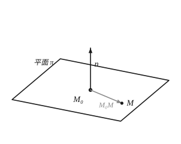
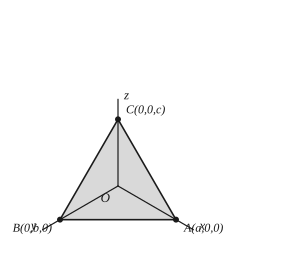
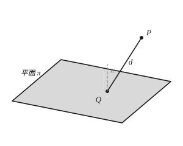

# 5.2 平面及其方程

确定一个平面，最经济的方式是“一个点 + 一个法向量”。点给出平面经过的位置，法向量给出平面的朝向。把“平面上任意一点与定点的连线都垂直于法向量”这个几何条件翻译成坐标，就得到平面的点法式方程。它是本节的核心，其他形式（一般式、截距式）都可以由它推出。

## 一、点法式方程

*图 5-3 平面的点法式与法向量*

**定义 5.1（法向量）** 如果非零向量 $\mathbf n$ 垂直于平面 $\pi$，则称 $\mathbf n$ 为平面 $\pi$ 的**法向量**。

设平面 $\pi$ 经过点 $M_0(x_0,y_0,z_0)$，法向量为 $\mathbf n=(A,B,C)$。对平面上任意一点 $M(x,y,z)$，向量
$$
\overrightarrow{M_0M}=(x-x_0,\ y-y_0,\ z-z_0)
$$
在平面内，所以它与法向量垂直：
$$
\mathbf n\cdot\overrightarrow{M_0M}=0.
$$
用坐标写出：
$$
A(x-x_0)+B(y-y_0)+C(z-z_0)=0.
$$
这就是平面的**点法式方程**。

反过来，满足这个方程的点都在过 $M_0$ 且以 $\mathbf n$ 为法向量的平面上。所以“点 + 法向量”唯一确定一个平面。

**例 5.1** 求过点 $M_0(1,2,-1)$ 且以 $\mathbf n=(2,-1,3)$ 为法向量的平面方程。

**解** 由点法式，
$$
2(x-1)-(y-2)+3(z+1)=0.
$$
展开：
$$
2x-2-y+2+3z+3=0,
$$
即
$$
2x-y+3z+3=0.
$$

**例 5.2** 求过三点 $A(1,0,0)$、$B(0,1,0)$、$C(0,0,1)$ 的平面方程。

*图 5-4 截距平面与三轴交点*

**解** 设平面的一般式为 $Ax+By+Cz+D=0$。代入三点：
$$
A+D=0,\qquad B+D=0,\qquad C+D=0.
$$
所以 $A=B=C=-D$。取 $D=-1$，得 $A=B=C=1$，平面方程为
$$
x+y+z=1.
$$
这个平面在三个坐标轴上的截距都是 $1$，称为**截距式**的特例。

**例 5.3** 求过点 $(1,-1,2)$ 且平行于平面 $2x-3y+z=5$ 的平面方程。

**解** 平行平面有相同的法向量，所以可取 $\mathbf n=(2,-3,1)$。由点法式，
$$
2(x-1)-3(y+1)+(z-2)=0,
$$
即
$$
2x-3y+z-7=0.
$$

**例 5.4** 求过点 $(1,2,3)$ 且垂直于直线
$$
\frac{x-1}{2}=\frac{y}{-1}=\frac{z+1}{3}
$$
的平面方程。

**解** 直线的方向向量为 $(2,-1,3)$。平面垂直于直线，意味着直线是平面的法线，所以法向量可取 $(2,-1,3)$。由点法式，
$$
2(x-1)-(y-2)+3(z-3)=0,
$$
即
$$
2x-y+3z-9=0.
$$
这里的关键是：**直线垂直于平面 ⇔ 直线的方向向量平行于平面的法向量**。

## 二、一般式方程

把点法式展开，得到
$$
Ax+By+Cz+D=0\qquad(A,B,C\ \text{不全为零}),
$$
称为平面的**一般式方程**。它的法向量就是 $(A,B,C)$，这一点要能做到“看到方程，立刻读出法向量”。

一般式中有一些特殊情形，反映了平面与坐标轴、坐标平面的位置关系：

| 方程特征 | 图形 |
| --- | --- |
| $D=0$ | 平面过原点 |
| $C=0$ | 平面平行于 $z$ 轴（或包含 $z$ 轴） |
| $A=0$ | 平面平行于 $x$ 轴 |
| $B=0$ | 平面平行于 $y$ 轴 |
| $A=B=0$ | 平面平行于 $xOy$ 平面（即 $z=\text{常数}$） |
| $A=D=0$ | 平面包含 $x$ 轴 |

理解这些结论的方法：法向量 $(A,B,C)$ 与某坐标轴垂直，平面就平行于该轴。例如 $C=0$ 时法向量 $(A,B,0)$ 垂直于 $z$ 轴，所以平面平行于 $z$ 轴。

**例 5.5** 指出下列方程表示的图形：
（1）$x=2$；（2）$y=0$；（3）$2x+3y=0$。

**解** （1）$x=2$ 表示过点 $(2,0,0)$ 且平行于 $yOz$ 平面的平面。
（2）$y=0$ 表示 $zOx$ 平面。
（3）$2x+3y=0$ 中 $C=0$、$D=0$，平面平行于 $z$ 轴且过原点，所以是过 $z$ 轴的一个平面。

## 三、平面之间的位置关系

设两个平面
$$
\pi_1:\ A_1x+B_1y+C_1z+D_1=0,\qquad
\pi_2:\ A_2x+B_2y+C_2z+D_2=0,
$$
法向量分别为 $\mathbf n_1=(A_1,B_1,C_1)$，$\mathbf n_2=(A_2,B_2,C_2)$。

**平行。**  两个平面平行，当且仅当法向量平行：
$$
\frac{A_1}{A_2}=\frac{B_1}{B_2}=\frac{C_1}{C_2}.
$$
如果这个比值还等于 $\dfrac{D_1}{D_2}$，则两个平面重合；否则平行但不重合。

**垂直。**  两个平面垂直，当且仅当法向量垂直：
$$
A_1A_2+B_1B_2+C_1C_2=0.
$$
这就是数量积的应用：法向量点积为零。

**夹角（拓展）。**  两个平面的夹角 $\theta$ 满足
$$
\cos\theta=\frac{|\mathbf n_1\cdot\mathbf n_2|}{|\mathbf n_1||\mathbf n_2|}.
$$
加绝对值是因为平面夹角取锐角。

**例 5.6** 判断平面 $2x-y+3z-1=0$ 与 $4x-2y+6z+5=0$ 的位置关系。

**解** 两个法向量分别为 $(2,-1,3)$ 与 $(4,-2,6)$。因为
$$
\frac{2}{4}=\frac{-1}{-2}=\frac{3}{6}=\frac12,
$$
法向量平行，所以两平面平行。又
$$
\frac{D_1}{D_2}=\frac{-1}{5}\neq\frac12,
$$
所以两平面不重合，是平行的两个不同平面。

**例 5.7** 判断平面 $x+2y-z=0$ 与 $2x-y+3z=1$ 的位置关系。

**解** 法向量分别为 $(1,2,-1)$ 与 $(2,-1,3)$。数量积
$$
1\cdot 2+2\cdot(-1)+(-1)\cdot 3=2-2-3=-3\neq 0,
$$
所以两平面不垂直。又对应系数不成比例，所以两平面不平行，相交于一条直线。

**例 5.8** 求过点 $(1,1,1)$ 且与平面 $x+2y-3z=0$ 平行的平面方程。

**解** 法向量相同，取 $(1,2,-3)$：
$$
(x-1)+2(y-1)-3(z-1)=0,
$$
即
$$
x+2y-3z=0.
$$
这个平面恰好与原平面重合，因为点 $(1,1,1)$ 满足原方程。这说明：**过一点且平行于已知平面的平面，可能与已知平面重合**；题目若要求“不重合”，需要额外条件。

## 四、点到平面的距离（拓展）

*图 5-5 点 P 向平面作垂线，垂足 Q*

点 $P(x_0,y_0,z_0)$ 到平面 $Ax+By+Cz+D=0$ 的距离为
$$
d=\frac{|Ax_0+By_0+Cz_0+D|}{\sqrt{A^2+B^2+C^2}}.
$$
这个公式的推导思路是：从 $P$ 作平面的垂线，垂足为 $Q$，则 $d=|\overrightarrow{PQ}|$；而 $\overrightarrow{PQ}$ 与法向量平行，利用数量积的投影即可得到公式。

**例 5.9** 求点 $(1,1,1)$ 到平面 $x+2y+2z-3=0$ 的距离。

**解**
$$
d=\frac{|1+2+2-3|}{\sqrt{1+4+4}}=\frac{2}{3}.
$$

## 五、常见误区

1. **把法向量与方向向量混淆。**  平面的法向量垂直于平面；直线的方向向量平行于直线。两者垂直、平行的条件正好“错位”。
2. **点法式符号写反。**  是 $A(x-x_0)+B(y-y_0)+C(z-z_0)=0$，点坐标前面是减号。
3. **看到一般式读不出法向量。**  $Ax+By+Cz+D=0$ 的法向量就是 $(A,B,C)$，与 $D$ 无关。
4. **平行条件与垂直条件记反。**  平面平行看系数成比例，平面垂直看法向量点积为零。
5. **认为 $D=0$ 表示平面平行于某轴。**  $D=0$ 表示平面过原点；平行于某轴看的是对应的系数是否为零。
6. **求过一点且平行于已知平面的平面时，忘记检查是否重合。**  如果该点就在已知平面上，得到的方程与原方程相同。

## 小结

1. 平面由“一点 + 法向量”唯一确定，点法式方程为 $A(x-x_0)+B(y-y_0)+C(z-z_0)=0$。
2. 一般式 $Ax+By+Cz+D=0$ 的法向量是 $(A,B,C)$；系数为零反映平面与坐标轴、坐标平面的位置关系。
3. 两平面平行 ⇔ 法向量平行（系数成比例）；两平面垂直 ⇔ 法向量点积为零。
4. 直线垂直于平面 ⇔ 直线的方向向量平行于平面的法向量。
5. 点到平面的距离公式是拓展内容，理解“投影”的思路即可。

下一节用“点 + 方向向量”确定空间直线，并讨论直线与直线、直线与平面的平行、垂直关系。
