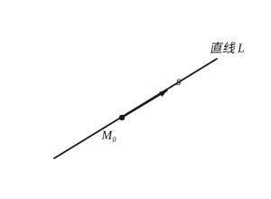
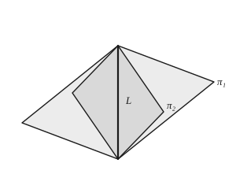

# 5.3 空间直线及其方程

与平面类似，空间直线也由“一个点 + 一个方向”确定。区别在于：平面用的是**法向量**（垂直于平面），直线用的是**方向向量**（平行于直线）。这一节先建立直线的点向式、参数式、一般式，再讨论直线与直线、直线与平面的平行、垂直关系。判断这些关系时，只要抓住“方向向量”和“法向量”的对应关系，就不会乱。

## 一、点向式方程

*图 5-6 空间直线的点向式与方向向量*

设直线 $L$ 经过点 $M_0(x_0,y_0,z_0)$，方向向量为 $\mathbf s=(m,n,p)$（$m,n,p$ 不全为零）。对直线上任意一点 $M(x,y,z)$，向量
$$
\overrightarrow{M_0M}=(x-x_0,\ y-y_0,\ z-z_0)
$$
与 $\mathbf s$ 平行，所以对应坐标成比例：
$$
\frac{x-x_0}{m}=\frac{y-y_0}{n}=\frac{z-z_0}{p}.
$$
这就是直线的**点向式方程**（也称对称式方程）。

当 $m,n,p$ 中有零时，比例式要理解为“分母为零则对应分子为零”。例如 $m=0$ 时，写成
$$
x=x_0,\qquad \frac{y-y_0}{n}=\frac{z-z_0}{p}.
$$
不能把分母为零的比值当成普通分数。

**例 5.1** 求过点 $(1,2,-1)$ 且方向向量为 $(2,-1,3)$ 的直线方程。

**解**
$$
\frac{x-1}{2}=\frac{y-2}{-1}=\frac{z+1}{3}.
$$

**例 5.2** 求过两点 $A(1,0,2)$、$B(3,1,-1)$ 的直线方程。

**解** 方向向量
$$
\mathbf s=\overrightarrow{AB}=(3-1,\ 1-0,\ -1-2)=(2,1,-3).
$$
取点 $A$，得
$$
\frac{x-1}{2}=\frac{y-0}{1}=\frac{z-2}{-3}.
$$

**例 5.3** 求过点 $(1,1,1)$ 且垂直于平面 $2x-y+3z=1$ 的直线方程。

**解** 直线垂直于平面，方向向量平行于平面的法向量，所以可取 $\mathbf s=(2,-1,3)$：
$$
\frac{x-1}{2}=\frac{y-1}{-1}=\frac{z-1}{3}.
$$
这里再次体现“线面垂直”的对应关系：**直线的方向向量 ∥ 平面的法向量**。

## 二、参数式方程

令点向式中的比值为 $t$：
$$
\frac{x-x_0}{m}=\frac{y-y_0}{n}=\frac{z-z_0}{p}=t.
$$
则
$$
\begin{cases}
x=x_0+mt,\\
y=y_0+nt,\\
z=z_0+pt.
\end{cases}
$$
这就是直线的**参数式方程**，$t$ 称为参数。参数式在求交点、判断位置关系时非常方便：把 $x,y,z$ 用 $t$ 表示，代入平面方程解出 $t$，就得到交点。

**例 5.4** 把直线 $\dfrac{x-1}{2}=\dfrac{y+1}{-1}=\dfrac{z}{3}$ 写成参数式。

**解** 令比值为 $t$：
$$
\begin{cases}
x=1+2t,\\
y=-1-t,\\
z=3t.
\end{cases}
$$

**例 5.5** 把参数式 $x=2-t$，$y=1+2t$，$z=-3t$ 写成点向式。

**解** 点为 $(2,1,0)$，方向向量为 $(-1,2,-3)$，所以
$$
\frac{x-2}{-1}=\frac{y-1}{2}=\frac{z}{-3}.
$$

## 三、一般式方程

*图 5-7 直线作为两不平行平面的交线*

空间直线可以看成两个不平行的平面的交线：
$$
\begin{cases}
A_1x+B_1y+C_1z+D_1=0,\\
A_2x+B_2y+C_2z+D_2=0.
\end{cases}
$$
这称为直线的**一般式方程**。两个平面的法向量分别为 $\mathbf n_1=(A_1,B_1,C_1)$、$\mathbf n_2=(A_2,B_2,C_2)$，直线的方向向量同时垂直于这两个法向量。

考纲不要求向量积，所以求方向向量可以用“取两点”的方法：令某个变量取两个不同的值，解出对应的 $x,y$，得到直线上两个点，再用终点减起点得到方向向量。

**例 5.6** 把一般式
$$
\begin{cases}
x+y+z=1,\\
x-y+z=0
\end{cases}
$$
化为点向式。

**解** 先找两个点。

令 $z=0$，则
$$
\begin{cases}
x+y=1,\\
x-y=0,
\end{cases}
$$
解得 $x=y=\dfrac12$，得到点 $M_1\left(\dfrac12,\dfrac12,0\right)$。

令 $z=1$，则
$$
\begin{cases}
x+y=0,\\
x-y=-1,
\end{cases}
$$
解得 $x=-\dfrac12$，$y=\dfrac12$，得到点 $M_2\left(-\dfrac12,\dfrac12,1\right)$。

方向向量
$$
\mathbf s=\overrightarrow{M_1M_2}=(-1,\ 0,\ 1).
$$
取 $M_1$，得
$$
\frac{x-\dfrac12}{-1}=\frac{y-\dfrac12}{0}=\frac{z}{1},
$$
即
$$
x-\frac12=-z,\qquad y=\frac12.
$$
（因为方向向量的 $y$ 分量为 $0$，所以写成 $y=\dfrac12$ 更清楚。）

## 四、直线与直线、直线与平面的位置关系

### 1. 直线与平面

设直线 $L$ 的方向向量为 $\mathbf s=(m,n,p)$，平面 $\pi$ 的法向量为 $\mathbf n=(A,B,C)$。

- **直线平行于平面**：$\mathbf s\perp\mathbf n$，即
$$
Am+Bn+Cp=0.
$$
如果此时直线上有一点在平面内，则直线**在平面内**；否则平行但不重合。

- **直线垂直于平面**：$\mathbf s\parallel\mathbf n$，即
$$
\frac{m}{A}=\frac{n}{B}=\frac{p}{C}.
$$

- **直线与平面相交**：把参数式代入平面方程，解出 $t$，再求交点。

**例 5.7** 判断直线
$$
\frac{x-1}{2}=\frac{y}{-1}=\frac{z+1}{3}
$$
与平面 $2x-y+3z=5$ 的位置关系，若相交，求交点。

**解** 直线的方向向量 $\mathbf s=(2,-1,3)$，平面的法向量 $\mathbf n=(2,-1,3)$，两者平行，所以直线垂直于平面。

写参数式：
$$
x=1+2t,\qquad y=-t,\qquad z=-1+3t.
$$
代入平面方程：
$$
2(1+2t)-(-t)+3(-1+3t)=5.
$$
化简：
$$
2+4t+t-3+9t=5\;\Longrightarrow\;14t-1=5\;\Longrightarrow\;t=\frac37.
$$
所以交点为
$$
\left(1+\frac67,\ -\frac37,\ -1+\frac97\right)
=\left(\frac{13}{7},-\frac37,\frac27\right).
$$

**例 5.8** 判断直线
$$
\frac{x-1}{1}=\frac{y}{-1}=\frac{z}{0}
$$
与平面 $x+y=0$ 的位置关系。

**解** 方向向量 $\mathbf s=(1,-1,0)$，法向量 $\mathbf n=(1,1,0)$，
$$
\mathbf s\cdot\mathbf n=1-1+0=0,
$$
所以直线平行于平面（或在其内）。取直线上点 $(1,0,0)$，代入平面：$1+0=1\neq 0$，点不在平面内。所以直线平行于平面，但不重合。

**例 5.9** 求过点 $(1,0,1)$ 且与平面 $x+2y-z=0$ 平行的直线方程（写出一个即可）。

**解** 方向向量要与法向量 $(1,2,-1)$ 垂直。取 $\mathbf s=(2,-1,0)$，则
$$
1\cdot 2+2\cdot(-1)+(-1)\cdot 0=0.
$$
所以直线可取
$$
\frac{x-1}{2}=\frac{y}{-1}=\frac{z-1}{0},
$$
即 $z=1$，$\dfrac{x-1}{2}=\dfrac{y}{-1}$。

### 2. 直线与直线

设两条直线的方向向量分别为 $\mathbf s_1,\mathbf s_2$。

- **平行**：$\mathbf s_1\parallel\mathbf s_2$；
- **垂直**：$\mathbf s_1\cdot\mathbf s_2=0$。

注意：空间两条直线“垂直”不一定相交。它们可能异面，但方向向量仍然可以垂直。考试中若要求“相交且垂直”，还要额外验证交点在两条直线上。

**例 5.10** 判断直线
$$
L_1:\ \frac{x-1}{2}=\frac{y}{1}=\frac{z+1}{-1},\qquad
L_2:\ \frac{x}{1}=\frac{y-2}{-2}=\frac{z}{3}
$$
的方向关系。

**解** $\mathbf s_1=(2,1,-1)$，$\mathbf s_2=(1,-2,3)$。
$$
\mathbf s_1\cdot\mathbf s_2=2-2-3=-3\neq 0,
$$
所以不垂直。又对应分量不成比例，所以不平行。两条直线方向既不平行也不垂直。

## 五、线面夹角（拓展）

直线与平面的夹角 $\theta$ 定义为直线与它在平面上的投影所成的锐角。设直线方向向量 $\mathbf s$，平面法向量 $\mathbf n$，则
$$
\sin\theta=\frac{|\mathbf s\cdot\mathbf n|}{|\mathbf s||\mathbf n|}.
$$
这里用 $\sin$ 而不是 $\cos$，因为 $\mathbf s$ 与 $\mathbf n$ 的夹角与线面角互余。

**例 5.11** 求直线 $\dfrac{x}{1}=\dfrac{y-1}{1}=\dfrac{z}{0}$ 与平面 $x+y+z=0$ 的夹角。

**解** $\mathbf s=(1,1,0)$，$\mathbf n=(1,1,1)$，
$$
\mathbf s\cdot\mathbf n=2,\qquad |\mathbf s|=\sqrt2,\qquad |\mathbf n|=\sqrt3.
$$
所以
$$
\sin\theta=\frac{2}{\sqrt6}=\frac{\sqrt6}{3}.
$$
从而 $\theta=\arcsin\dfrac{\sqrt6}{3}$。

## 六、常见误区

1. **方向向量与法向量混淆。**  直线用方向向量（平行），平面用法向量（垂直）；线面垂直的条件是“方向向量 ∥ 法向量”，不是“方向向量 ⊥ 法向量”。
2. **点向式中分母为零不会处理。**  $m=0$ 时应写成 $x=x_0$，不能写成 $\dfrac{x-x_0}{0}$。
3. **一般式求方向向量用错。**  方向向量同时垂直于两个平面的法向量；用“取两点”的方法最稳妥。
4. **直线平行于平面，误判为直线在平面内。**  还要检查直线上一点是否在平面内。
5. **两条直线垂直就认为相交。**  空间中可以异面垂直。
6. **求线面交点时代入错方程。**  把参数式代入平面方程，解出 $t$，再回代求坐标。

## 小结

1. 直线由“一点 + 方向向量”确定，点向式为 $\dfrac{x-x_0}{m}=\dfrac{y-y_0}{n}=\dfrac{z-z_0}{p}$。
2. 参数式 $x=x_0+mt,\ y=y_0+nt,\ z=z_0+pt$，适合求交点。
3. 一般式是两个平面的交线；求方向向量可用“取两点”的方法。
4. 线面平行：$\mathbf s\cdot\mathbf n=0$；线面垂直：$\mathbf s\parallel\mathbf n$。
5. 线线平行：$\mathbf s_1\parallel\mathbf s_2$；线线垂直：$\mathbf s_1\cdot\mathbf s_2=0$（不一定相交）。

下一节讲空间曲面中最基本的两种：球面与柱面。球面由“到定点距离等于定长”定义，柱面由“母线平行于某方向”定义，它们的方程都有很明显的特征。
