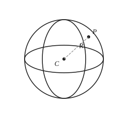
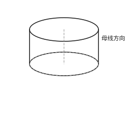
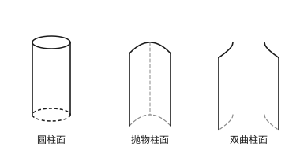

# 5.4 球面与柱面

空间曲面的一般方程是 $F(x,y,z)=0$，满足方程的点构成一张曲面。考纲只要求“了解球面方程及母线平行于坐标轴的柱面方程”，范围不大，但这两类曲面是理解空间图形的基础。它们的方程有很明显的特征：球面看“平方和”，柱面看“缺哪个变量”。

## 一、球面：到定点的距离等于定长

*图 5-8 球面：球心 C、半径 R 与点 P*

**定义 5.1（球面）** 空间中到定点 $C(a,b,c)$ 的距离等于定长 $R$ 的所有点组成的曲面，称为**球面**，$C$ 称为球心，$R$ 称为半径。

设球面上任意一点为 $P(x,y,z)$，则 $|CP|=R$，即
$$
\sqrt{(x-a)^2+(y-b)^2+(z-c)^2}=R.
$$
两边平方，得**球面的标准方程**：
$$
(x-a)^2+(y-b)^2+(z-c)^2=R^2.
$$

当球心在原点时，方程简化为
$$
x^2+y^2+z^2=R^2.
$$

把标准方程展开，得到**一般方程**：
$$
x^2+y^2+z^2+Dx+Ey+Fz+G=0.
$$
它的特点是：$x^2,y^2,z^2$ 的系数相同（通常化为 $1$），没有 $xy,yz,zx$ 这样的交叉项。

反过来，给出一般方程，可以用**配方法**化成标准形式，从而读出球心和半径。

**例 5.1** 求球心为 $(1,-2,3)$、半径为 $2$ 的球面方程。

**解**
$$
(x-1)^2+(y+2)^2+(z-3)^2=4.
$$

**例 5.2** 求球面 $x^2+y^2+z^2-2x+4y-6z+5=0$ 的球心与半径。

**解** 分别对 $x,y,z$ 配方：
$$
x^2-2x=(x-1)^2-1,
$$
$$
y^2+4y=(y+2)^2-4,
$$
$$
z^2-6z=(z-3)^2-9.
$$
代入原方程：
$$
(x-1)^2+(y+2)^2+(z-3)^2-1-4-9+5=0,
$$
即
$$
(x-1)^2+(y+2)^2+(z-3)^2=9.
$$
所以球心为 $(1,-2,3)$，半径 $R=3$。

**例 5.3** 说明方程 $x^2+y^2+z^2+1=0$ 表示什么图形。

**解** 左边恒大于等于 $1$，不可能等于 $0$，所以方程不表示任何实图形（虚球面）。类似地，$x^2+y^2+z^2=0$ 只表示原点一个点，是退化的球面。配方后如果右边小于零，就没有实图形；等于零，就是一个点。

**例 5.4** 球面 $x^2+y^2+z^2=R^2$ 与平面 $z=0$ 的交线是什么？

**解** 把 $z=0$ 代入球面方程，得
$$
x^2+y^2=R^2,\qquad z=0.
$$
这是 $xOy$ 平面内以原点为圆心、$R$ 为半径的圆。注意：**在空间中，$x^2+y^2=R^2$ 单独出现时是柱面，不是圆**；只有与平面 $z=0$ 联立，才表示一个圆。

## 二、柱面：母线平行于定方向

*图 5-9 圆柱面及其母线*

**定义 5.2（柱面）** 由一条动直线（母线）沿一条定曲线（准线）平行移动所形成的曲面，称为**柱面**。母线的方向称为柱面的方向，准线可以是任意曲线。

考纲只要求“母线平行于坐标轴”的柱面。这类柱面有一个非常明显的方程特征：**方程中缺少与母线方向对应的变量**。

- 母线平行于 $z$ 轴：方程形如 $F(x,y)=0$，不含 $z$；
- 母线平行于 $x$ 轴：方程形如 $F(y,z)=0$，不含 $x$；
- 母线平行于 $y$ 轴：方程形如 $F(x,z)=0$，不含 $y$。

为什么？以母线平行于 $z$ 轴为例：准线在 $xOy$ 平面内，方程为 $F(x,y)=0$。把准线上的每一点沿 $z$ 轴方向平移，$x,y$ 不变，$z$ 任意，所以整条母线都满足 $F(x,y)=0$，与 $z$ 无关。

常见的柱面：

*图 5-10 圆柱面、抛物柱面、双曲柱面*

| 方程 | 母线方向 | 名称 |
| --- | --- | --- |
| $x^2+y^2=R^2$ | $z$ 轴 | 圆柱面 |
| $y^2=2px$ | $z$ 轴 | 抛物柱面 |
| $\dfrac{x^2}{a^2}-\dfrac{y^2}{b^2}=1$ | $z$ 轴 | 双曲柱面 |
| $x^2+z^2=R^2$ | $y$ 轴 | 圆柱面 |
| $y^2=z$ | $x$ 轴 | 抛物柱面 |

**例 5.5** 说明 $x^2+z^2=1$ 表示什么曲面。

**解** 方程不含 $y$，所以母线平行于 $y$ 轴；在 $xOz$ 平面内，$x^2+z^2=1$ 是单位圆。因此它是母线平行于 $y$ 轴的圆柱面。

**例 5.6** 说明 $y^2=z$ 表示什么曲面。

**解** 方程不含 $x$，母线平行于 $x$ 轴；在 $yOz$ 平面内，$y^2=z$ 是抛物线。因此它是母线平行于 $x$ 轴的抛物柱面。

**例 5.7** 求以曲线
$$
\begin{cases}
x^2+y^2=1,\\
z=0
\end{cases}
$$
为准线、母线平行于 $z$ 轴的柱面方程。

**解** 母线平行于 $z$ 轴，柱面方程不含 $z$。把准线方程中的 $z=0$ 去掉，得
$$
x^2+y^2=1.
$$
这就是所求的圆柱面方程。几何上，准线是 $xOy$ 平面内的单位圆，沿 $z$ 轴平移得到圆柱面。

**例 5.8** 求以曲线
$$
\begin{cases}
y=x^2,\\
z=0
\end{cases}
$$
为准线、母线平行于 $z$ 轴的柱面方程。

**解** 去掉 $z=0$，得
$$
y=x^2.
$$
这是母线平行于 $z$ 轴的抛物柱面。

**例 5.9** 说明 $x^2+y^2=2x$ 表示什么曲面。

**解** 方程不含 $z$，母线平行于 $z$ 轴。对 $x$ 配方：
$$
x^2-2x+y^2=0\;\Longrightarrow\;(x-1)^2+y^2=1.
$$
所以它是母线平行于 $z$ 轴、准线为 $xOy$ 平面内圆 $(x-1)^2+y^2=1$ 的圆柱面。

**例 5.10** 说明 $x^2+y^2+z^2=2z$ 表示什么曲面。

**解** 这是球面方程，不是柱面。配方：
$$
x^2+y^2+(z-1)^2=1.
$$
球心为 $(0,0,1)$，半径为 $1$。判断的关键是：三个变量都以平方形式出现，且没有缺变量，通常是球面（或椭球面）；缺一个变量才是柱面。

## 三、怎样识别曲面方程

拿到一个三元方程，可以按下面的顺序判断：

1. **看是否缺变量**：缺哪个变量，母线就平行于哪个轴，是柱面；
2. **看平方项系数**：$x^2,y^2,z^2$ 系数相同、无交叉项，尝试配方，可能是球面；
3. **看方程次数**：一次方程是平面；二次方程可能是球面、柱面、锥面等（考纲只要求球面与柱面）；
4. **配方**：把一般式化成标准式，读出球心、半径，或准线方程。

**例 5.11** 判断下列方程表示什么曲面：
（1）$x^2+y^2=4$；（2）$x^2+y^2+z^2=4$；（3）$x+y+z=4$。

**解** （1）缺 $z$，母线平行于 $z$ 轴，是圆柱面（准线为 $xOy$ 平面内半径 $2$ 的圆）。
（2）三个变量平方和，是球心在原点、半径 $2$ 的球面。
（3）一次方程，是平面。

这三个方程只差一点，图形完全不同。**看方程先看“次数”和“缺哪个变量”**，是最快的判断方法。

## 四、常见误区

1. **把 $x^2+y^2=R^2$ 当成圆。** 在平面内它是圆；在空间中它表示母线平行于 $z$ 轴的圆柱面。圆是它与某个平面的交线。
2. **球面一般式忘记配方。** $x^2+y^2+z^2+Dx+Ey+Fz+G=0$ 必须先配方，才能读出球心和半径。
3. **配方后右边为负仍说是球面。** 右边小于零表示没有实图形；等于零表示一个点。
4. **柱面方程一定缺变量。** 这只对“母线平行于坐标轴”的柱面成立；斜柱面的方程不一定缺变量。考纲只要求前者。
5. **把“缺变量”理解成“没有这个方向的限制”。** 缺 $z$ 意味着 $z$ 可以任意，所以沿 $z$ 轴无限延伸，正是柱面的特征。
6. **球面与柱面混淆。** 球面三个平方项都有，柱面缺一个变量；这是最直接的区分。

## 小结

1. 球面标准方程：$(x-a)^2+(y-b)^2+(z-c)^2=R^2$；一般式通过配方法化为标准式。
2. 球面一般式的特征是三个平方项系数相同、无交叉项；配方后右边小于零无实图形，等于零为一个点。
3. 母线平行于坐标轴的柱面，方程缺少对应变量：缺 $z$ 平行于 $z$ 轴，缺 $x$ 平行于 $x$ 轴，缺 $y$ 平行于 $y$ 轴。
4. 常见柱面：圆柱面、抛物柱面、双曲柱面。
5. 识别曲面先看“次数”和“缺哪个变量”，再考虑配方。

第五章到此结束。下一章进入常微分方程：已知函数与它的导数之间的关系，如何把未知函数求出来。我们会从最基本的概念开始，逐步掌握可分离变量、一阶线性、可降阶、二阶常系数齐次等类型。
