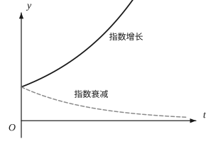

# 6.6 微分方程的应用

微分方程的价值在于“翻译”：把现实中的变化规律翻译成方程，解出未知函数，再回到现实解释。很多实际问题的核心句式是“某个量的变化率与它本身（或与某个差）成正比”。把这句话写成导数，方程就出来了。这一节按模型类型整理：指数增长/衰减、牛顿冷却、混合问题、几何问题、简谐振动。

## 一、建模的五个步骤

1. **设未知函数**：明确哪个量随哪个变量变化，设 $y=y(t)$ 或 $y=y(x)$；
2. **找变化率关系**：把“速度”“增长率”“冷却速度”等翻译成 $\dfrac{\mathrm dy}{\mathrm dt}$ 或 $\dfrac{\mathrm dy}{\mathrm dx}$；
3. **列方程与初始条件**：根据题意写出微分方程，并找出初始时刻（或初始点）的值；
4. **解方程**：判断类型（可分离、一阶线性、二阶常系数等），选择对应解法；
5. **解释结果**：把数学结果翻译回实际，注意单位、定义域和实际意义。

第 2 步是关键。常见的关键词与数学表达对应如下：

| 实际说法 | 数学表达 |
| --- | --- |
| 增长率与当前数量成正比 | $\dfrac{\mathrm dy}{\mathrm dt}=ky$ |
| 冷却速度与温差成正比 | $\dfrac{\mathrm dT}{\mathrm dt}=-k(T-T_m)$ |
| 切线的斜率为…… | $\dfrac{\mathrm dy}{\mathrm dx}=\cdots$ |
| 流入速率 − 流出速率 | $\dfrac{\mathrm dy}{\mathrm dt}=R_{\text{in}}-R_{\text{out}}$ |
| 加速度与位移成正比且反向 | $y''=-\omega^2y$ |

## 二、指数增长与衰减

*图 6-2 指数增长与指数衰减曲线*

最简单也最常用的模型是
$$
\frac{\mathrm dy}{\mathrm dt}=ky.
$$
当 $k>0$ 时表示增长，$k<0$ 时表示衰减。分离变量并积分：
$$
y=Ce^{kt}.
$$
若初始值 $y(0)=y_0$，则
$$
y=y_0e^{kt}.
$$

**例 6.1（细菌增长）** 某细菌培养液中初始有 $1000$ 个细菌，$2$ 小时后增至 $3000$ 个。假设增长率与细菌数成正比，求 $t$ 时刻的细菌数，并求细菌数达到 $10000$ 所需时间。

**解** 设细菌数为 $y(t)$，则
$$
y'=ky,\qquad y(0)=1000.
$$
解为 $y=1000e^{kt}$。由 $y(2)=3000$：
$$
3000=1000e^{2k}\;\Longrightarrow\;e^{2k}=3\;\Longrightarrow\;k=\frac{\ln 3}{2}.
$$
所以
$$
y=1000e^{\frac{\ln3}{2}t}=1000\cdot 3^{t/2}.
$$
令 $y=10000$：
$$
3^{t/2}=10\;\Longrightarrow\;\frac t2\ln3=\ln10\;\Longrightarrow\;t=\frac{2\ln10}{\ln3}\approx 4.19\ \text{小时}.
$$

**例 6.2（放射性衰变）** 某放射性物质的半衰期为 $T$，求其质量随时间变化的规律。

**解** 设质量为 $m(t)$，衰变速度与当前质量成正比：
$$
m'=-km\qquad(k>0).
$$
解为 $m=m_0e^{-kt}$。半衰期条件 $m(T)=\dfrac{m_0}{2}$ 给出
$$
\frac12=e^{-kT}\;\Longrightarrow\;k=\frac{\ln2}{T}.
$$
所以
$$
m(t)=m_0e^{-\frac{\ln2}{T}t}=m_0\left(\frac12\right)^{t/T}.
$$

**例 6.3（人口增长）** 某地区人口以每年 $2\%$ 的速率增长，初始人口为 $100$ 万。求人口翻倍所需时间。

**解** $P'=0.02P$，$P(0)=100$，所以 $P=100e^{0.02t}$（单位：万）。令 $P=200$：
$$
e^{0.02t}=2\;\Longrightarrow\;t=\frac{\ln2}{0.02}\approx 34.7\ \text{年}.
$$

## 三、牛顿冷却定律

**牛顿冷却定律**：物体温度 $T$ 的变化率与它和周围介质温度 $T_m$ 的差成正比：
$$
\frac{\mathrm dT}{\mathrm dt}=-k(T-T_m)\qquad(k>0).
$$
令 $u=T-T_m$，则 $u'=-ku$，所以
$$
u=Ce^{-kt},\qquad T=T_m+Ce^{-kt}.
$$
若初始温度 $T(0)=T_0$，则 $C=T_0-T_m$，
$$
T(t)=T_m+(T_0-T_m)e^{-kt}.
$$

**例 6.4** 一杯 $90^\circ\text{C}$ 的咖啡放在 $20^\circ\text{C}$ 的房间里，$10$ 分钟后温度降为 $70^\circ\text{C}$。求温度随时间变化的规律，并求温度降到 $40^\circ\text{C}$ 所需时间。

**解** $T_m=20$，$T_0=90$，所以
$$
T(t)=20+70e^{-kt}.
$$
由 $T(10)=70$：
$$
70=20+70e^{-10k}\;\Longrightarrow\;e^{-10k}=\frac57,
$$
$$
k=-\frac{1}{10}\ln\frac57=\frac{1}{10}\ln\frac75\approx 0.03365.
$$
所以
$$
T(t)=20+70e^{-0.03365t}.
$$
令 $T=40$：
$$
40=20+70e^{-kt}\;\Longrightarrow\;e^{-kt}=\frac27,
$$
$$
t=\frac{\ln(7/2)}{k}\approx\frac{1.2528}{0.03365}\approx 37.2\ \text{分钟}.
$$

## 四、混合问题：一阶线性模型

水箱中盐量的变化，是“流入速率 − 流出速率”的典型问题。设 $y(t)$ 为盐量，$V(t)$ 为液体体积，流入浓度为 $c_{\text{in}}$，流入速率为 $r_{\text{in}}$，流出速率为 $r_{\text{out}}$，则
$$
\frac{\mathrm dy}{\mathrm dt}=c_{\text{in}}r_{\text{in}}-\frac{y}{V}r_{\text{out}}.
$$
如果流入、流出速率相等，$V$ 保持不变；如果不等，$V$ 也随时间变化，问题会更复杂。

**例 6.5** 水箱中有 $100\text{ L}$ 水，含盐 $10\text{ kg}$。以 $2\text{ L/min}$ 的速率流入含盐 $0.5\text{ kg/L}$ 的盐水，同时以 $2\text{ L/min}$ 的速率流出，充分搅拌。求 $t$ 时刻水箱中的盐量。

**解** 设盐量为 $y(t)$（kg）。流入盐的速率为
$$
0.5\times 2=1\ \text{kg/min}.
$$
流出的盐水浓度为 $\dfrac{y}{100}$（kg/L），流出速率为 $2$ L/min，所以流出盐的速率为
$$
2\cdot\frac{y}{100}=\frac{y}{50}\ \text{kg/min}.
$$
因此
$$
y'=1-\frac{y}{50},\qquad y(0)=10.
$$
化为标准形：
$$
y'+\frac{1}{50}y=1.
$$
这是一阶线性方程，$P=\dfrac{1}{50}$，$Q=1$。积分因子 $e^{t/50}$：
$$
y=e^{-t/50}\left[\int e^{t/50}\,\mathrm dt+C\right]
=e^{-t/50}\left[50e^{t/50}+C\right]
=50+Ce^{-t/50}.
$$
由 $y(0)=10$：
$$
10=50+C\;\Longrightarrow\;C=-40.
$$
所以
$$
y=50-40e^{-t/50}.
$$
当 $t\to+\infty$ 时，$y\to 50$ kg，正好是“浓度 $0.5$ kg/L × 体积 $100$ L”的平衡值。

## 五、几何应用：由切线性质求曲线

几何问题的关键是“把切线斜率翻译成导数”。题目说“曲线上任一点处的切线斜率为……”，就是给出 $\dfrac{\mathrm dy}{\mathrm dx}$ 的表达式。

**例 6.6** 已知曲线过点 $(1,2)$，且曲线上任一点处的切线斜率等于 $2x$，求曲线方程。

**解** 由题意
$$
y'=2x.
$$
积分：
$$
y=x^2+C.
$$
代入 $y(1)=2$：
$$
2=1+C\;\Longrightarrow\;C=1.
$$
所以
$$
y=x^2+1.
$$

**例 6.7** 已知曲线过点 $(0,1)$，且曲线上任一点处的切线斜率等于该点的横坐标与纵坐标之和，求曲线方程。

**解** 由题意
$$
y'=x+y,\qquad y(0)=1.
$$
化为标准形：
$$
y'-y=x.
$$
$P=-1$，$Q=x$，积分因子 $e^{-x}$：
$$
y=e^{x}\left[\int xe^{-x}\,\mathrm dx+C\right]
=e^{x}\left[-(x+1)e^{-x}+C\right]
=Ce^{x}-x-1.
$$
由 $y(0)=1$：
$$
1=C-1\;\Longrightarrow\;C=2.
$$
所以
$$
y=2e^{x}-x-1.
$$

## 六、简谐振动：二阶常系数模型

弹簧振子满足
$$
mx''+kx=0,
$$
其中 $m$ 是质量，$k$ 是劲度系数。化为
$$
x''+\omega^2x=0,\qquad \omega=\sqrt{\frac km}.
$$
由 6.5 节，通解为
$$
x=C_1\cos\omega t+C_2\sin\omega t.
$$
若初始位移 $x(0)=x_0$、初始速度 $x'(0)=0$，则 $C_1=x_0$，$C_2=0$，所以
$$
x=x_0\cos\omega t.
$$
这是简谐振动：振幅 $x_0$，角频率 $\omega$，周期 $T=\dfrac{2\pi}{\omega}=2\pi\sqrt{\dfrac mk}$。

**例 6.8** 一弹簧振子的位移满足 $x''+4x=0$，初始位移 $x(0)=0.1\text{ m}$，初始速度 $x'(0)=0$。求位移函数与周期。

**解** 特征方程 $r^2+4=0$，根为 $\pm 2i$，通解
$$
x=C_1\cos 2t+C_2\sin 2t.
$$
由 $x(0)=0.1$ 得 $C_1=0.1$；$x'=-0.2\sin 2t+2C_2\cos 2t$，由 $x'(0)=0$ 得 $C_2=0$。所以
$$
x=0.1\cos 2t.
$$
周期
$$
T=\frac{2\pi}{2}=\pi\ \text{s}.
$$

## 七、常见误区

1. **正负号搞反。**  衰减、冷却的导数应为负；如果设 $y'=ky$ 且 $k>0$，得到的是增长而不是衰减。
2. **初始条件代错时刻。**  题目说“10 分钟后”，初始条件是 $t=0$ 时的值，不是 $t=10$。
3. **单位不统一。**  时间用小时还是分钟、体积用升还是立方米，列方程前要统一。
4. **混合问题流出浓度写错。**  流出浓度是 $\dfrac{y}{V}$，不是初始浓度，也不是流入浓度。
5. **把“变化率”当成“变化量”。**  “增长率为 $2\%$”通常指 $\dfrac{y'}{y}=0.02$，不是 $y'=0.02$。
6. **几何题忘记用经过的点定常数。**  通解中的 $C$ 要靠初始条件确定。
7. **二阶振动问题忘记两个初始条件。**  位移和速度各给一个，才能定两个常数。

## 小结

1. 建模五步：设函数、找变化率、列方程与初始条件、解方程、解释结果。
2. 指数模型 $y'=ky$：$y=y_0e^{kt}$；$k>0$ 增长，$k<0$ 衰减。
3. 牛顿冷却：$T=T_m+(T_0-T_m)e^{-kt}$。
4. 混合问题：$\dfrac{\mathrm dy}{\mathrm dt}=c_{\text{in}}r_{\text{in}}-\dfrac{y}{V}r_{\text{out}}$，通常是一阶线性方程。
5. 几何问题：切线斜率就是导数，积分后用经过的点定常数。
6. 简谐振动：$x''+\omega^2x=0$，解为 $x=C_1\cos\omega t+C_2\sin\omega t$。

第六章到此结束，整套教程也到此结束。回过头看，六章其实是一条线：极限是语言，导数是局部变化率，积分是累积，微分方程是“已知变化率关系求函数”，空间解析几何则提供了另一种几何语言。把这条件线索抓住，零散的知识点就不再是孤立的公式，而是一张有结构的网。
