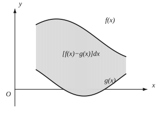
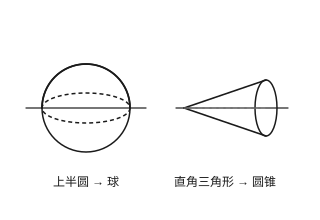
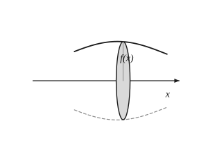
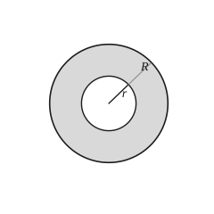

# 4.9 定积分的应用

定积分是“累积”的工具。只要一个量可以分解成无数个“微小部分”，而每个微小部分又近似等于“某个函数 × 微小长度”，就可以用定积分把它累加起来。这个思想叫**微元法**。这一节用它处理三类问题：平面图形的面积、旋转体的体积、变力做功，最后顺带讲平均值与变速运动的位移、路程。

## 一、微元法：先写一小块，再积分

用定积分求量的步骤可以概括为四步：

1. **选变量**：选取积分变量（通常是 $x$ 或 $y$），确定它的变化区间 $[a,b]$；
2. **取微元**：在区间内取一小段 $[x,x+\mathrm dx]$，写出这一小段对应的量 $\mathrm dA$ 的近似表达式；
3. **写积分**：把 $\mathrm dA$ 从 $a$ 到 $b$ 积分，得到总量 $A=\displaystyle\int_a^b\mathrm dA$；
4. **计算**：用牛顿—莱布尼茨公式算出结果。

第 2 步是关键。$\mathrm dA$ 必须写成“函数值 × 微小长度”的形式，例如 $\mathrm dA=f(x)\mathrm dx$、$\mathrm dV=\pi f^2(x)\mathrm dx$、$\mathrm dW=F(x)\mathrm dx$。只要微元写对，积分就是例行公事。

## 二、平面图形的面积

### 1. 曲边梯形

如果 $f(x)\ge 0$，则由 $y=f(x)$、$x$ 轴、$x=a$、$x=b$ 围成的曲边梯形面积为
$$
A=\int_a^b f(x)\,\mathrm dx.
$$
如果 $f(x)\le 0$，面积是积分的相反数：
$$
A=-\int_a^b f(x)\,\mathrm dx.
$$

### 2. 两曲线之间的面积

*图 4-5 两曲线之间的条带面积*

如果 $f(x)\ge g(x)$ 在 $[a,b]$ 上成立，则由两条曲线围成的图形面积为
$$
A=\int_a^b[f(x)-g(x)]\,\mathrm dx.
$$
**上曲线减下曲线**，这是最不容易出错的形式。如果两条曲线在区间内交叉，要先求出交点，分段积分。

### 3. 以 $y$ 为积分变量

如果图形由 $x=\varphi(y)$、$y$ 轴、$y=c$、$y=d$ 围成，则面积为
$$
A=\int_c^d|\varphi(y)|\,\mathrm dy,
$$
或“右曲线减左曲线”：
$$
A=\int_c^d[\varphi_{\text{右}}(y)-\varphi_{\text{左}}(y)]\,\mathrm dy.
$$
有些图形沿 $x$ 方向分割很麻烦，沿 $y$ 方向却很简单，这时要果断换变量。

**例 4.1** 求由 $y=x^2$ 与 $y=x$ 围成的图形面积。

**解** 先求交点：
$$
x^2=x\;\Longrightarrow\;x=0\ \text{或}\ x=1.
$$
在 $[0,1]$ 上，$x\ge x^2$，所以上曲线是 $y=x$，下曲线是 $y=x^2$：
$$
A=\int_0^1(x-x^2)\,\mathrm dx
=\left[\frac{x^2}{2}-\frac{x^3}{3}\right]_0^1
=\frac12-\frac13=\frac16.
$$

**例 4.2** 求由 $y=\sqrt x$ 与 $y=x^2$ 围成的图形面积。

**解** 交点为 $x=0$ 与 $x=1$。在 $[0,1]$ 上，$\sqrt x\ge x^2$：
$$
A=\int_0^1(\sqrt x-x^2)\,\mathrm dx
=\left[\frac23x^{3/2}-\frac{x^3}{3}\right]_0^1
=\frac23-\frac13=\frac13.
$$

**例 4.3** 求由 $y=x^2-2x$ 与 $x$ 轴围成的图形面积。

**解** 先求与 $x$ 轴的交点：
$$
x^2-2x=x(x-2)=0\;\Longrightarrow\;x=0,2.
$$
在 $(0,2)$ 内，$x^2-2x<0$，曲线在 $x$ 轴下方，所以面积是积分的相反数：
$$
A=-\int_0^2(x^2-2x)\,\mathrm dx
=-\left[\frac{x^3}{3}-x^2\right]_0^2
=-\left(\frac83-4\right)=\frac43.
$$
如果直接算积分，会得到 $-\dfrac43$；面积必须取正，这一点要特别注意。

**例 4.4** 求由 $y=\ln x$、$x=e$ 与 $x$ 轴围成的图形面积。

**解** $y=\ln x$ 与 $x$ 轴交于 $x=1$，在 $[1,e]$ 上 $\ln x\ge 0$：
$$
A=\int_1^e\ln x\,\mathrm dx.
$$
由 4.7 节例 4.14，$\displaystyle\int_1^e\ln x\,\mathrm dx=1$。所以面积为 $1$。

**例 4.5** 求由 $x=y^2$ 与 $x=y+2$ 围成的图形面积。

**解** 先求交点：
$$
y^2=y+2\;\Longrightarrow\;y^2-y-2=0\;\Longrightarrow\;y=-1,2.
$$
在 $[-1,2]$ 上，右曲线是 $x=y+2$，左曲线是 $x=y^2$：
$$
A=\int_{-1}^2[(y+2)-y^2]\,\mathrm dy
=\left[\frac{y^2}{2}+2y-\frac{y^3}{3}\right]_{-1}^2.
$$
计算：
$$
\left(2+4-\frac83\right)-\left(\frac12-2+\frac13\right)
=\frac{10}{3}-\left(-\frac76\right)
=\frac{10}{3}+\frac76=\frac{20+7}{6}=\frac92.
$$
这个例子如果沿 $x$ 积分，要分成两段，沿 $y$ 积分只需一段。选择积分变量很重要。

## 三、旋转体的体积

*图 4-8 上半圆旋转成球、直线旋转成圆锥*

### 1. 绕 $x$ 轴旋转：圆盘法

*图 4-6 圆盘法的截面圆*

设 $f(x)\ge 0$，曲线 $y=f(x)$ 在 $[a,b]$ 上与 $x$ 轴围成的图形绕 $x$ 轴旋转，得到旋转体。在 $x$ 处取微元，截面是半径为 $f(x)$ 的圆，面积为 $\pi f^2(x)$，厚度为 $\mathrm dx$，所以体积微元为
$$
\mathrm dV=\pi f^2(x)\,\mathrm dx.
$$
积分得
$$
V=\pi\int_a^b f^2(x)\,\mathrm dx.
$$

### 2. 两曲线之间的旋转体：垫圈法

*图 4-7 垫圈法的圆环截面*

如果图形由 $y=f(x)$（外曲线）与 $y=g(x)$（内曲线）围成（$f\ge g\ge 0$），绕 $x$ 轴旋转，截面是圆环，面积为 $\pi[f^2(x)-g^2(x)]$，所以
$$
V=\pi\int_a^b\left[f^2(x)-g^2(x)\right]\mathrm dx.
$$

**例 4.6** 求 $y=\sqrt x$ 在 $[0,4]$ 上与 $x$ 轴围成的图形绕 $x$ 轴旋转所得旋转体的体积。

**解**
$$
V=\pi\int_0^4(\sqrt x)^2\,\mathrm dx=\pi\int_0^4 x\,\mathrm dx
=\pi\cdot\frac{x^2}{2}\Big|_0^4=8\pi.
$$

**例 4.7** 证明半径为 $R$ 的球体体积为 $\dfrac43\pi R^3$。

**解** 球可以看成上半圆 $y=\sqrt{R^2-x^2}$（$-R\le x\le R$）绕 $x$ 轴旋转而成：
$$
V=\pi\int_{-R}^R(R^2-x^2)\,\mathrm dx
=\pi\left[R^2x-\frac{x^3}{3}\right]_{-R}^R.
$$
代入：
$$
V=\pi\left[\left(R^3-\frac{R^3}{3}\right)-\left(-R^3+\frac{R^3}{3}\right)\right]
=\pi\cdot\frac{4R^3}{3}=\frac43\pi R^3.
$$

**例 4.8** 证明底面半径为 $r$、高为 $h$ 的圆锥体积为 $\dfrac13\pi r^2h$。

**解** 圆锥可以看成直线 $y=\dfrac rhx$（$0\le x\le h$）绕 $x$ 轴旋转而成：
$$
V=\pi\int_0^h\left(\frac rhx\right)^2\mathrm dx
=\pi\cdot\frac{r^2}{h^2}\cdot\frac{h^3}{3}
=\frac13\pi r^2h.
$$

**例 4.9** 求由 $y=x$ 与 $y=x^2$ 围成的图形绕 $x$ 轴旋转所得旋转体的体积。

**解** 交点为 $x=0,1$。在 $[0,1]$ 上 $x\ge x^2$，外半径 $x$，内半径 $x^2$：
$$
V=\pi\int_0^1\left[x^2-(x^2)^2\right]\mathrm dx
=\pi\int_0^1(x^2-x^4)\,\mathrm dx
=\pi\left(\frac13-\frac15\right)=\frac{2\pi}{15}.
$$

> **拓展：柱壳法。** 如果图形绕 $y$ 轴旋转，用圆盘法要对 $y$ 积分，有时不方便。此时可以用柱壳法：在 $x$ 处取宽为 $\mathrm dx$、高为 $f(x)$ 的竖条，绕 $y$ 轴旋转形成一个薄柱壳，体积微元为 $2\pi x f(x)\mathrm dx$，所以 $V=2\pi\displaystyle\int_a^b xf(x)\mathrm dx$。考纲不要求，但了解它有助于理解“同一旋转体，不同切法”。

## 四、变力做功

如果物体在变力 $F(x)$ 作用下沿 $x$ 轴从 $a$ 移动到 $b$，且力的方向与位移方向一致，则做功为
$$
W=\int_a^b F(x)\,\mathrm dx.
$$
微元是 $\mathrm dW=F(x)\mathrm dx$：在一小段位移上，力近似不变，功等于力乘位移。

**例 4.10** 弹簧的伸长量与所受拉力成正比。已知将弹簧从自然长度拉伸 $a$ 时，求拉力所做的功。

**解** 设 $F(x)=kx$，其中 $x$ 是伸长量，$k$ 是劲度系数。则
$$
W=\int_0^a kx\,\mathrm dx=\frac12ka^2.
$$
这就是弹簧弹性势能的公式。

**例 4.11** 一物体在变力 $F(x)=x^2+1$（单位：N）作用下，沿 $x$ 轴从 $x=0$ 移动到 $x=2$（单位：m），求做的功。

**解**
$$
W=\int_0^2(x^2+1)\,\mathrm dx
=\left[\frac{x^3}{3}+x\right]_0^2
=\frac83+2=\frac{14}{3}\ \text{J}.
$$

## 五、平均值与变速运动的位移、路程

**函数的平均值。** 函数 $f$ 在 $[a,b]$ 上的平均值为
$$
\bar f=\frac{1}{b-a}\int_a^b f(x)\,\mathrm dx.
$$
这是积分中值定理的另一种写法：存在 $\xi$，使 $\bar f=f(\xi)$。

**变速直线运动的位移。** 如果速度 $v=v(t)$，则在 $[t_1,t_2]$ 内的位移为
$$
s=\int_{t_1}^{t_2}v(t)\,\mathrm dt.
$$
如果速度有正有负，这个积分仍是**位移**，正负部分会相互抵消；要求路程，应对 $|v(t)|$ 积分。

**例 4.12** 质点速度 $v(t)=t^2$（m/s），求 $0\le t\le 2$ 内的位移。

**解**
$$
s=\int_0^2 t^2\,\mathrm dt=\frac83\ \text{m}.
$$

**例 4.13** 求 $f(x)=\sin x$ 在 $[0,\pi]$ 上的平均值。

**解**
$$
\bar f=\frac{1}{\pi-0}\int_0^\pi\sin x\,\mathrm dx=\frac{1}{\pi}\cdot 2=\frac2\pi.
$$

## 六、常见误区

1. **面积直接积分，不判断正负。** 曲线在 $x$ 轴下方时，积分是负的，面积要取相反数。
2. **两曲线上下顺序搞反。** 用“上减下”，如果不确定，先画草图或代一个点。
3. **曲线交叉不分段。** 如果 $f-g$ 在区间内变号，必须求交点分段积分。
4. **旋转体体积漏掉 $\pi$ 或平方。** 圆盘法是 $\pi f^2(x)$，不是 $f^2(x)$，也不是 $\pi f(x)$。
5. **内半径、外半径搞反。** 垫圈法是“外平方减内平方”，顺序反了会得到负体积。
6. **绕 $y$ 轴旋转仍用 $\pi f^2(x)\mathrm dx$。** 绕 $y$ 轴要用柱壳法或对 $y$ 积分，不能直接套圆盘法。
7. **做功的力与位移方向不一致。** 公式 $W=\int F\mathrm dx$ 适用于力与位移同向；如果方向有夹角，要乘 $\cos\theta$。

## 小结

1. 微元法是定积分应用的核心：取一小段，写出 $\mathrm dA$，再积分。
2. 面积：曲边梯形 $\displaystyle\int f$；两曲线之间 $\displaystyle\int(\text{上}-\text{下})$；必要时对 $y$ 积分。
3. 旋转体体积：绕 $x$ 轴圆盘法 $V=\pi\displaystyle\int f^2\mathrm dx$；两曲线之间用垫圈法 $\pi\displaystyle\int(f^2-g^2)\mathrm dx$。
4. 变力做功：$W=\displaystyle\int_a^b F(x)\mathrm dx$。
5. 平均值：$\bar f=\dfrac{1}{b-a}\displaystyle\int_a^b f$；变速运动位移对速度积分，路程对速度的绝对值积分。
6. 计算前先画草图、求交点、判断上下曲线和正负，能避免大部分错误。

第四章到此结束。下一章离开一维，进入空间解析几何：用坐标和向量描述空间中的点、直线、平面与曲面。
