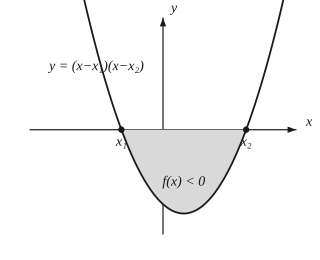

# 0.3 方程与不等式

方程回答“什么时候相等”，不等式回答“在哪些范围里成立”。高数里两者都离不开：求定义域要解不等式，求驻点要解方程，判断单调性要解 $f'(x)>0$，求极限有时要先解出临界点。这一节把一次、二次、分式、根式、绝对值五类问题串起来。

## 一、一元一次方程

形如
$$
ax+b=0\quad(a\neq 0)
$$
的方程叫一元一次方程，解为
$$
x=-\frac{b}{a}.
$$
若 $a=0$，方程变成 $b=0$：当 $b=0$ 时任意实数都是解，当 $b\neq 0$ 时无解。这个“退化情形”在含参数问题里经常出现，不能默认 $a\neq 0$。

## 二、一元二次方程

形如
$$
ax^2+bx+c=0\quad(a\neq 0)
$$
的方程，先用判别式判断根的情况：
$$
\Delta=b^2-4ac.
$$
- $\Delta>0$：两个不相等的实根；
- $\Delta=0$：两个相等的实根（重根）；
- $\Delta<0$：没有实根。

有实根时，求根公式为
$$
x_{1,2}=\frac{-b\pm\sqrt{b^2-4ac}}{2a}.
$$
两根与系数还有**韦达定理**：
$$
x_1+x_2=-\frac{b}{a},\qquad x_1x_2=\frac{c}{a}.
$$
韦达定理在不解方程、只判断根的符号或求对称式时特别有用。

**例 0.1** 解方程 $2x^2-5x+2=0$。

**解** $\Delta=(-5)^2-4\cdot 2\cdot 2=25-16=9>0$，所以
$$
x=\frac{5\pm 3}{4},
$$
即 $x_1=2$，$x_2=\dfrac{1}{2}$。

**例 0.2** 已知方程 $x^2-3x+k=0$ 的两根之积为 $-4$，求 $k$，并判断根的情况。

**解** 由韦达定理 $x_1x_2=k$，所以 $k=-4$。此时
$$
\Delta=(-3)^2-4\cdot 1\cdot(-4)=9+16=25>0,
$$
方程有两个不相等的实根。

## 三、一元二次不等式

*图 0-4 抛物线与不等式解集区间*

解二次不等式，先求对应方程的根，再结合抛物线开口判断符号。设 $a>0$，方程 $ax^2+bx+c=0$ 的两根为 $x_1<x_2$，则
$$
ax^2+bx+c>0\iff x<x_1\ \text{或}\ x>x_2,
$$
$$
ax^2+bx+c<0\iff x_1<x<x_2.
$$
记忆方法是“**大于取两边，小于取中间**”，前提是二次项系数为正。若 $a<0$，先两边同乘 $-1$ 并改变不等号方向，把二次项系数化正。

**例 0.3** 解不等式 $x^2-5x+6<0$。

**解** 方程 $x^2-5x+6=0$ 的根为 $2,3$，开口向上，所以小于零的部分在两根之间：
$$
2<x<3,
$$
解集为 $(2,3)$。

**例 0.4** 解不等式 $-2x^2+x+1\ge 0$。

**解** 两边同乘 $-1$，不等号反向：
$$
2x^2-x-1\le 0.
$$
方程 $2x^2-x-1=0$ 的根为 $x=1$ 和 $x=-\dfrac{1}{2}$，开口向上，小于等于零的部分在两根之间：
$$
-\frac{1}{2}\le x\le 1.
$$

## 四、分式不等式

分式不等式不能直接“交叉相乘”，因为分母的符号未知，乘过去可能改变不等号方向。正确做法是：**移项、通分、化成一个大分式，再用符号表判断**。

**例 0.5** 解不等式 $\dfrac{x-1}{x+2}\le 0$。

**解** 分子为零于 $x=1$，分母为零于 $x=-2$。把数轴分成三段，判断 $\dfrac{x-1}{x+2}$ 的符号：

| 区间 | $x-1$ | $x+2$ | 分式 |
| --- | --- | --- | --- |
| $x<-2$ | $-$ | $-$ | $+$ |
| $-2<x<1$ | $-$ | $+$ | $-$ |
| $x>1$ | $+$ | $+$ | $+$ |

分式小于等于零的区间是 $(-2,1]$。注意 $x=1$ 时分子为零，分式等于零，可以取；$x=-2$ 时分母为零，不能取。

## 五、绝对值不等式

绝对值不等式用“距离”理解最快：
$$
|x-a|<r\iff a-r<x<a+r\quad(r>0),
$$
$$
|x-a|>r\iff x<a-r\ \text{或}\ x>a+r\quad(r>0).
$$
若右边是 $0$ 或负数，要单独判断：$|x-a|<0$ 无解，$|x-a|>0$ 的解是 $x\neq a$。

**例 0.6** 解不等式 $|2x+1|\ge 3$。

**解** 去掉绝对值，得到两个不等式：
$$
2x+1\le -3\quad\text{或}\quad 2x+1\ge 3.
$$
分别解得 $x\le -2$ 或 $x\ge 1$，解集为
$$
(-\infty,-2]\cup[1,+\infty).
$$

## 六、根式方程：平方之后必须验根

含根号的方程，通常先把根号孤立在一边，再两边平方。但平方不是等价变形，可能产生**增根**，所以最后必须代回原方程检验。

**例 0.7** 解方程 $\sqrt{x+1}=x-1$。

**解** 首先要求 $x+1\ge 0$，且右边 $x-1\ge 0$（因为左边非负），所以 $x\ge 1$。两边平方：
$$
x+1=(x-1)^2=x^2-2x+1,
$$
整理得
$$
x^2-3x=0,
$$
即 $x=0$ 或 $x=3$。$x=0$ 不满足 $x\ge 1$，舍去；代回检验 $x=3$：$\sqrt{4}=2=3-1$，成立。所以原方程的解为 $x=3$。

## 七、含参数的一次不等式

形如 $ax>b$ 的不等式，解集取决于 $a$ 的符号：
- $a>0$：$x>\dfrac{b}{a}$；
- $a<0$：$x<\dfrac{b}{a}$（不等号反向）；
- $a=0$：若 $b<0$，则 $0>b$ 恒成立，解为全体实数；若 $b\ge 0$，无解。

这类讨论在判断含参函数的单调性时会出现。关键不是背三种情况，而是记住：**除以一个数时，先问它是正、是负、还是零。**

## 八、易错点

1. **不等式两边乘负数，必须变号。** 这是最高频的错误。
2. **分式不等式不能直接交叉相乘。** 先移项通分，再用符号表。
3. **二次不等式先看二次项系数。** 系数为负时先化正，否则“大于取两边”会用反。
4. **平方可能增根。** 根式方程、含绝对值的方程，平方后都要检验。
5. **端点要单独判断。** 分母为零的点永远不能取；分子为零的点通常可以取（前提是分母不为零）。

## 九、与高数的接口

- **定义域**：偶次根号内非负、分母非零、对数真数为正，最终都化成不等式组。
- **单调性**：解 $f'(x)>0$ 得单调递增区间，解 $f'(x)<0$ 得递减区间。
- **极值**：驻点是 $f'(x)=0$ 的解；还要判断导数在驻点两侧的符号。
- **极限**：保号性、夹逼准则都要用不等式估计；$\varepsilon$-$\delta$ 证明本质上是解绝对值不等式。

## 练习

1. 解方程 $x^2-4x-5=0$。
2. 解不等式 $x^2+x-6\ge 0$。
3. 解不等式 $\dfrac{x+3}{x-1}>0$。
4. 解方程 $\sqrt{2x+3}=x$。

**答案**

1. $(x-5)(x+1)=0$，$x=5$ 或 $x=-1$。
2. 根为 $-3,2$，开口向上，解集为 $(-\infty,-3]\cup[2,+\infty)$。
3. 临界点为 $-3,1$，符号为正的区间是 $(-\infty,-3)\cup(1,+\infty)$。
4. 要求 $x\ge 0$。平方得 $2x+3=x^2$，即 $x^2-2x-3=0$，$x=3$ 或 $x=-1$。$x=-1$ 不满足 $x\ge 0$，舍去；$x=3$ 代回成立，解为 $x=3$。
