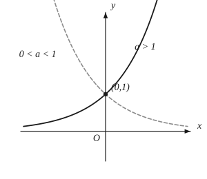
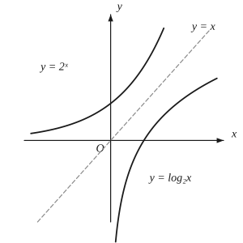

# 0.5 指数与对数

指数与对数是高中代数里最容易被“背公式”掩盖的一对概念。它们其实是一件事的两面：**指数函数 $y=a^x$ 问“底数 $a$ 的 $x$ 次方是多少”，对数函数 $y=\log_a x$ 问“$a$ 的多少次方等于 $x$”**。高数里，$e^x$ 和 $\ln x$ 是最重要的两个基本初等函数，求导、积分、极限都绕不开它们。

## 一、指数幂的扩充

先从正整数指数开始：
$$
a^n=\underbrace{a\cdot a\cdots a}_{n\text{ 个}}.
$$
为了让 $a^m\div a^n=a^{m-n}$ 在 $m<n$ 时也成立，规定
$$
a^0=1\quad(a\neq 0),\qquad a^{-n}=\frac{1}{a^n}\quad(a\neq 0).
$$
为了让开方运算也纳入指数，规定（以下总设 $a>0$，$m,n$ 为正整数）
$$
a^{1/n}=\sqrt[n]{a},\qquad a^{m/n}=\sqrt[n]{a^m}.
$$
要求 $a>0$ 是为了避免偶次根号下出现负数带来的符号歧义。例如 $(-8)^{1/3}$ 按实数理解为 $-2$，但 $(-8)^{2/6}$ 就会产生歧义；统一在正底数下讨论，运算律才没有例外。

指数运算律（$a>0,b>0$，$x,y\in\mathbb{R}$）：
$$
a^x a^y=a^{x+y},\qquad \frac{a^x}{a^y}=a^{x-y},\qquad (a^x)^y=a^{xy},\qquad (ab)^x=a^x b^x.
$$
注意 $(a^x)^y=a^{xy}$ 与 $a^{x^y}$ 完全不同，后者是先算 $x^y$ 再作指数。

## 二、指数函数

*图 0-9 指数函数族（a>1 与 0<a<1）*

形如
$$
y=a^x\quad(a>0,\ a\neq 1)
$$
的函数叫**指数函数**，定义域为 $\mathbb{R}$，值域为 $(0,+\infty)$。它的图像总在 $x$ 轴上方，且经过点 $(0,1)$。

- 当 $a>1$ 时，$y=a^x$ 单调递增；$x\to-\infty$ 时趋于 $0$，$x\to+\infty$ 时趋于 $+\infty$。
- 当 $0<a<1$ 时，$y=a^x$ 单调递减；$x\to-\infty$ 时趋于 $+\infty$，$x\to+\infty$ 时趋于 $0$。

两种情况的图像都以 $x$ 轴为水平渐近线。高数里最常用的底数是 $e\approx 2.71828$，因为 $e^x$ 的导数等于它自己。

**例 0.1** 比较 $2^{0.3}$ 与 $2^{0.5}$ 的大小。

**解** 底数 $2>1$，函数 $y=2^x$ 单调递增；又 $0.3<0.5$，所以
$$
2^{0.3}<2^{0.5}.
$$

## 三、对数的定义

**定义 0.1（对数）** 设 $a>0$，$a\neq 1$，$N>0$。若
$$
a^x=N,
$$
则称 $x$ 为以 $a$ 为底 $N$ 的对数，记作
$$
x=\log_a N.
$$
简单说，$\log_a N$ 就是“$a$ 的多少次方等于 $N$”。由定义直接得到两条基本值：
$$
\log_a 1=0,\qquad \log_a a=1.
$$
常用两种特殊记号：以 $10$ 为底记作 $\lg N$，以 $e$ 为底记作 $\ln N$。

对数与指数互为反运算：
$$
a^{\log_a N}=N\quad(N>0),\qquad \log_a(a^x)=x\quad(x\in\mathbb{R}).
$$
这两条式子是“指数与对数可以互相抵消”的准确表述，解题时经常用来脱去指数或对数。

**例 0.2** 求 $\log_2 8$、$\log_3\dfrac{1}{9}$、$\ln e^2$。

**解** 因为 $2^3=8$，所以 $\log_2 8=3$；因为 $3^{-2}=\dfrac{1}{9}$，所以 $\log_3\dfrac{1}{9}=-2$；因为 $\ln e^2=2\ln e=2$。

## 四、对数的运算律

设 $a>0$，$a\neq 1$，$M>0$，$N>0$，$r\in\mathbb{R}$，则
$$
\log_a(MN)=\log_a M+\log_a N,
$$
$$
\log_a\frac{M}{N}=\log_a M-\log_a N,
$$
$$
\log_a M^r=r\log_a M.
$$
换底公式把不同底的对数统一：
$$
\log_a N=\frac{\log_b N}{\log_b a}\quad(b>0,\ b\neq 1).
$$
特别地，
$$
\log_a N=\frac{\ln N}{\ln a}.
$$
换底公式在比较大小、解含不同底的对数方程时很有用。

**注意**：对数运算律只对**乘除、幂**有效，对加减没有分配律：
$$
\log_a(M+N)\neq\log_a M+\log_a N.
$$
这是最常见的错误之一。$\log_a(M+N)$ 一般不能拆开。

**例 0.3** 化简 $\log_2 12-\log_2 3$。

**解**
$$
\log_2 12-\log_2 3=\log_2\frac{12}{3}=\log_2 4=2.
$$

**例 0.4** 用 $\ln$ 表示 $\log_3 5$。

**解** 由换底公式
$$
\log_3 5=\frac{\ln 5}{\ln 3}.
$$

## 五、对数函数

*图 0-10 同底指数与对数函数关于 y = x 对称*

形如
$$
y=\log_a x\quad(a>0,\ a\neq 1)
$$
的函数叫**对数函数**，定义域为 $(0,+\infty)$，值域为 $\mathbb{R}$，图像经过点 $(1,0)$。

- 当 $a>1$ 时，$y=\log_a x$ 单调递增；
- 当 $0<a<1$ 时，$y=\log_a x$ 单调递减。

对数函数与同底的指数函数互为反函数，图像关于直线 $y=x$ 对称。例如 $y=e^x$ 与 $y=\ln x$ 关于 $y=x$ 对称。

**例 0.5** 求 $f(x)=\ln(x-1)+\dfrac{1}{\sqrt{3-x}}$ 的定义域。

**解** 对数真数为正，分母不为零且根号内为正：
$$
x-1>0,\qquad 3-x>0.
$$
即 $1<x<3$，定义域为 $(1,3)$。

## 六、简单的指数、对数方程

解指数方程，常用“同底化”或“取对数”：
$$
a^{f(x)}=a^{g(x)}\iff f(x)=g(x)\quad(a>0,\ a\neq 1).
$$
若两边底数不同，可以两边取同底对数。

**例 0.6** 解方程 $2^{x}=5$。

**解** 两边取以 $2$ 为底的对数：
$$
x=\log_2 5.
$$
若用自然对数表示，由换底公式 $x=\dfrac{\ln 5}{\ln 2}$。

解对数方程，先保证真数为正，再用“同底化”：
$$
\log_a f(x)=\log_a g(x)\iff f(x)=g(x)\quad(f(x)>0,\ g(x)>0).
$$
解完必须检验，防止增根。

**例 0.7** 解方程 $\log_2(x+1)=3$。

**解** 由定义，$x+1=2^3=8$，所以 $x=7$。检验：$x+1=8>0$，成立。

## 七、易错点

1. **$\log_a(M+N)\neq\log_a M+\log_a N$。** 对数只把乘除变成加减，不把加减变成什么简单的东西。
2. **对数的真数必须为正。** $\ln 0$、$\ln(-1)$ 在实数范围内没有定义。
3. **底数必须满足 $a>0$ 且 $a\neq 1$。** 底数为 $1$ 时，$1^x=1$ 永远成立，无法定义唯一的对数。
4. **$a^0=1$ 的前提是 $a\neq 0$。** $0^0$ 没有定义。
5. **$(a^x)^y=a^{xy}$，但 $a^{x^y}$ 是先算 $x^y$。** 指数的结合顺序不能随意换。

## 八、与高数的接口

- **极限**：$\lim\limits_{x\to 0}\dfrac{\ln(1+x)}{x}=1$、$\lim\limits_{x\to 0}\dfrac{e^x-1}{x}=1$ 都来自指数与对数的性质。
- **导数**：$(e^x)'=e^x$，$(\ln x)'=\dfrac{1}{x}$，$(a^x)'=a^x\ln a$，$(\log_a x)'=\dfrac{1}{x\ln a}$。
- **对数求导法**：对 $y=f(x)^{g(x)}$ 两边取对数，把幂变成乘积，再求导。
- **积分**：$\displaystyle\int\frac{1}{x}\,\mathrm dx=\ln|x|+C$，$\displaystyle\int e^x\,\mathrm dx=e^x+C$。

## 练习

1. 计算 $\log_4 16$、$\log_5\dfrac{1}{25}$。
2. 化简 $\lg 2+\lg 5$。
3. 解方程 $3^{x+1}=5$。
4. 求 $f(x)=\log_2(4-x)$ 的定义域。

**答案**

1. $2$；$-2$。
2. $\lg(2\cdot 5)=\lg 10=1$。
3. $x+1=\log_3 5$，所以 $x=\log_3 5-1=\dfrac{\ln 5}{\ln 3}-1$。
4. $4-x>0$，定义域为 $(-\infty,4)$。
