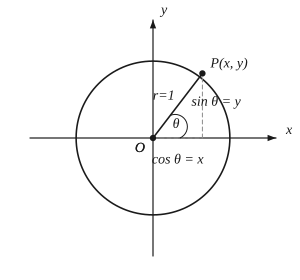
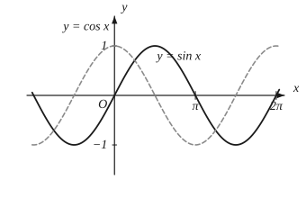
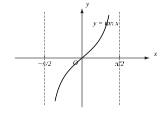
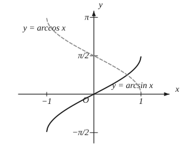
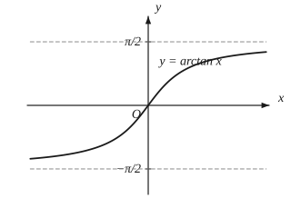

# 0.6 三角函数与反三角函数

三角函数描述周期现象，也是高数里最常用的一类初等函数。第一个重要极限
$$
\lim_{x\to 0}\frac{\sin x}{x}=1
$$
离不开正弦函数的图像；求导公式 $(\sin x)'=\cos x$、$(\arctan x)'=\dfrac{1}{1+x^2}$ 也以三角恒等式为基础。这一节从弧度制讲起，把定义、图像、常用恒等式和反三角函数串起来。

## 一、角与弧度

角可以用度数度量，也可以用弧度度量。** 弧度的定义**是：弧长等于半径的圆心角为 $1$ 弧度。因为半径为 $r$ 的圆周长是 $2\pi r$，所以一个周角是 $2\pi$ 弧度，即
$$
360^\circ=2\pi\ \text{rad},\qquad 180^\circ=\pi\ \text{rad}.
$$
常用的换算：
$$
30^\circ=\frac{\pi}{6},\quad 45^\circ=\frac{\pi}{4},\quad 60^\circ=\frac{\pi}{3},\quad 90^\circ=\frac{\pi}{2}.
$$
在高数里，三角函数的自变量默认用弧度。写 $\lim\limits_{x\to 0}\dfrac{\sin x}{x}=1$ 时，$x$ 是弧度；如果用角度，这个极限会变成 $\dfrac{\pi}{180}$。所以**看到三角函数，先确认单位是弧度**。

半径为 $r$、圆心角为 $\theta$（弧度）的弧长为
$$
l=r\theta,
$$
扇形面积为
$$
S=\frac{1}{2}r^2\theta.
$$

## 二、用单位圆定义三角函数

*图 0-11 单位圆定义 sin θ、cos θ、tan θ*

在平面直角坐标系中，以原点为圆心、半径为 $1$ 的圆叫**单位圆**。从 $x$ 轴正半轴出发，逆时针旋转角 $\theta$，终边与单位圆交于点 $P(x,y)$，则定义
$$
\sin\theta=y,\qquad \cos\theta=x,\qquad \tan\theta=\frac{y}{x}\quad(x\neq 0).
$$
这个定义把三角函数从“直角三角形边长比”推广到了任意角，也直接给出了周期性和符号规律。

四个象限中三角函数的符号：

| 象限 | $\sin\theta$ | $\cos\theta$ | $\tan\theta$ |
| --- | --- | --- | --- |
| 第一象限 | $+$ | $+$ | $+$ |
| 第二象限 | $+$ | $-$ | $-$ |
| 第三象限 | $-$ | $-$ | $+$ |
| 第四象限 | $-$ | $+$ | $-$ |

特殊角的函数值必须熟记：

| $\theta$ | $0$ | $\dfrac{\pi}{6}$ | $\dfrac{\pi}{4}$ | $\dfrac{\pi}{3}$ | $\dfrac{\pi}{2}$ |
| --- | --- | --- | --- | --- | --- |
| $\sin\theta$ | $0$ | $\dfrac{1}{2}$ | $\dfrac{\sqrt{2}}{2}$ | $\dfrac{\sqrt{3}}{2}$ | $1$ |
| $\cos\theta$ | $1$ | $\dfrac{\sqrt{3}}{2}$ | $\dfrac{\sqrt{2}}{2}$ | $\dfrac{1}{2}$ | $0$ |
| $\tan\theta$ | $0$ | $\dfrac{\sqrt{3}}{3}$ | $1$ | $\sqrt{3}$ | 不存在 |

## 三、同角关系与诱导公式

由单位圆定义，$x^2+y^2=1$，所以
$$
\sin^2\theta+\cos^2\theta=1.
$$
两边除以 $\cos^2\theta$（$\cos\theta\neq 0$），得
$$
1+\tan^2\theta=\frac{1}{\cos^2\theta}.
$$
正切与正弦、余弦的关系是
$$
\tan\theta=\frac{\sin\theta}{\cos\theta}\quad(\cos\theta\neq 0).
$$

**诱导公式**把任意角的三角函数化到第一象限。核心规律是“奇变偶不变，符号看象限”，但初学时不建议只背口诀，最好结合单位圆理解。常用的几组：

$$
\sin(-\theta)=-\sin\theta,\qquad \cos(-\theta)=\cos\theta,\qquad \tan(-\theta)=-\tan\theta,
$$
$$
\sin(\pi-\theta)=\sin\theta,\qquad \cos(\pi-\theta)=-\cos\theta,
$$
$$
\sin(\pi+\theta)=-\sin\theta,\qquad \cos(\pi+\theta)=-\cos\theta,
$$
$$
\sin\left(\frac{\pi}{2}-\theta\right)=\cos\theta,\qquad \cos\left(\frac{\pi}{2}-\theta\right)=\sin\theta.
$$
这些公式说明：正弦是奇函数，余弦是偶函数；$\pi$ 的整数倍改变符号，$\dfrac{\pi}{2}$ 的奇数倍交换正弦与余弦。

## 四、和角公式与倍角公式

两角和差公式是三角恒等变形的核心：
$$
\sin(\alpha\pm\beta)=\sin\alpha\cos\beta\pm\cos\alpha\sin\beta,
$$
$$
\cos(\alpha\pm\beta)=\cos\alpha\cos\beta\mp\sin\alpha\sin\beta,
$$
$$
\tan(\alpha\pm\beta)=\frac{\tan\alpha\pm\tan\beta}{1\mp\tan\alpha\tan\beta}.
$$
注意余弦公式中间的符号与左边相反：$\cos(\alpha+\beta)$ 对应减号，$\cos(\alpha-\beta)$ 对应加号。

令 $\beta=\alpha$，得到**二倍角公式**：
$$
\sin 2\alpha=2\sin\alpha\cos\alpha,
$$
$$
\cos 2\alpha=\cos^2\alpha-\sin^2\alpha=2\cos^2\alpha-1=1-2\sin^2\alpha.
$$
二倍角公式在积分里常反过来用，用来降幂：
$$
\sin^2\alpha=\frac{1-\cos 2\alpha}{2},\qquad \cos^2\alpha=\frac{1+\cos 2\alpha}{2}.
$$

**例 0.1** 求 $\sin\dfrac{7\pi}{6}$。

**解** $\dfrac{7\pi}{6}=\pi+\dfrac{\pi}{6}$，由诱导公式
$$
\sin\left(\pi+\frac{\pi}{6}\right)=-\sin\frac{\pi}{6}=-\frac{1}{2}.
$$

**例 0.2** 已知 $\sin\alpha=\dfrac{3}{5}$，且 $\alpha$ 在第二象限，求 $\cos\alpha$ 与 $\tan\alpha$。

**解** 由 $\sin^2\alpha+\cos^2\alpha=1$，
$$
\cos^2\alpha=1-\frac{9}{25}=\frac{16}{25}.
$$
第二象限余弦为负，所以 $\cos\alpha=-\dfrac{4}{5}$，从而
$$
\tan\alpha=\frac{\sin\alpha}{\cos\alpha}=\frac{3/5}{-4/5}=-\frac{3}{4}.
$$

## 五、三角函数的图像与性质

*图 0-12 正弦函数与余弦函数*

*图 0-13 正切函数及其垂直渐近线*

**正弦函数** $y=\sin x$：定义域 $\mathbb{R}$，值域 $[-1,1]$，周期 $2\pi$，奇函数。它在 $\left[-\dfrac{\pi}{2}+2k\pi,\dfrac{\pi}{2}+2k\pi\right]$ 上递增，在 $\left[\dfrac{\pi}{2}+2k\pi,\dfrac{3\pi}{2}+2k\pi\right]$ 上递减。

**余弦函数** $y=\cos x$：定义域 $\mathbb{R}$，值域 $[-1,1]$，周期 $2\pi$，偶函数。它在 $[-\pi+2k\pi,2k\pi]$ 上递增，在 $[2k\pi,\pi+2k\pi]$ 上递减。

**正切函数** $y=\tan x$：定义域为 $x\neq\dfrac{\pi}{2}+k\pi$，值域 $\mathbb{R}$，周期 $\pi$，奇函数。它在每个区间 $\left(-\dfrac{\pi}{2}+k\pi,\dfrac{\pi}{2}+k\pi\right)$ 内递增，但这些区间之间不连续，不能把“每个区间递增”说成“在整个定义域上递增”。

$y=A\sin(\omega x+\varphi)$ 的周期为
$$
T=\frac{2\pi}{|\omega|},
$$
振幅为 $|A|$。这个形式在物理里描述简谐振动，在高数里主要用于理解周期性与图像变换。

**例 0.3** 求 $y=3\sin\left(2x+\dfrac{\pi}{3}\right)$ 的周期与最大值。

**解** 周期 $T=\dfrac{2\pi}{2}=\pi$，最大值为 $3$。

## 六、反三角函数

*图 0-14a arcsin x 与 arccos x*

*图 0-14b arctan x 与水平渐近线*

三角函数是周期函数，整体上不是一一对应，所以反三角函数必须**限制定义域**。

**反正弦** $y=\arcsin x$：定义域 $[-1,1]$，值域 $\left[-\dfrac{\pi}{2},\dfrac{\pi}{2}\right]$，满足
$$
\sin(\arcsin x)=x,\qquad \arcsin(\sin x)=x\ \text{仅当}\ x\in\left[-\frac{\pi}{2},\frac{\pi}{2}\right].
$$

**反余弦** $y=\arccos x$：定义域 $[-1,1]$，值域 $[0,\pi]$，满足
$$
\cos(\arccos x)=x.
$$

**反正切** $y=\arctan x$：定义域 $\mathbb{R}$，值域 $\left(-\dfrac{\pi}{2},\dfrac{\pi}{2}\right)$，满足
$$
\tan(\arctan x)=x.
$$
当 $x\to+\infty$ 时 $\arctan x\to\dfrac{\pi}{2}$，当 $x\to-\infty$ 时 $\arctan x\to-\dfrac{\pi}{2}$，所以它有两条水平渐近线。这个性质在求极限时经常用到。

**例 0.4** 求 $\arcsin\dfrac{1}{2}$、$\arccos 0$、$\arctan 1$。

**解** 因为 $\sin\dfrac{\pi}{6}=\dfrac{1}{2}$ 且 $\dfrac{\pi}{6}\in\left[-\dfrac{\pi}{2},\dfrac{\pi}{2}\right]$，所以 $\arcsin\dfrac{1}{2}=\dfrac{\pi}{6}$。因为 $\cos\dfrac{\pi}{2}=0$ 且 $\dfrac{\pi}{2}\in[0,\pi]$，所以 $\arccos 0=\dfrac{\pi}{2}$。因为 $\tan\dfrac{\pi}{4}=1$，所以 $\arctan 1=\dfrac{\pi}{4}$。

**例 0.5** 解方程 $\sin x=\dfrac{1}{2}$，其中 $x\in[0,2\pi]$。

**解** 正弦值为 $\dfrac{1}{2}$ 的角在第一、二象限。由 $\sin\dfrac{\pi}{6}=\dfrac{1}{2}$，得
$$
x=\frac{\pi}{6}\quad\text{或}\quad x=\pi-\frac{\pi}{6}=\frac{5\pi}{6}.
$$

## 七、易错点

1. **$\sin(\alpha+\beta)\neq\sin\alpha+\sin\beta$。**  三角函数对加法没有分配律。
2. **$\cos(\alpha+\beta)$ 的符号与展开式中间项相反。**  这是背公式时最容易错的地方。
3. **正切在 $\dfrac{\pi}{2}+k\pi$ 处无定义。**  看到 $\tan$ 先检查分母 $\cos\theta$ 是否为零。
4. **$\arcsin(\sin x)$ 不一定等于 $x$。**  只有当 $x\in\left[-\dfrac{\pi}{2},\dfrac{\pi}{2}\right]$ 时才成立。
5. **角度与弧度不能混用。**  高数公式默认弧度；把 $30^\circ$ 直接代入 $\sin x/x$ 会得到错误结果。

## 八、与高数的接口

- **重要极限**：$\lim\limits_{x\to 0}\dfrac{\sin x}{x}=1$，$\lim\limits_{x\to 0}\dfrac{1-\cos x}{x^2}=\dfrac{1}{2}$。
- **导数**：$(\sin x)'=\cos x$，$(\cos x)'=-\sin x$，$(\tan x)'=\sec^2 x$。
- **反三角导数**：$(\arcsin x)'=\dfrac{1}{\sqrt{1-x^2}}$，$(\arctan x)'=\dfrac{1}{1+x^2}$。
- **积分**：$\displaystyle\int\sin x\,\mathrm dx=-\cos x+C$，$\displaystyle\int\cos x\,\mathrm dx=\sin x+C$；三角恒等式常用于降幂和换元。

## 练习

1. 求 $\cos\dfrac{5\pi}{3}$。
2. 已知 $\cos\alpha=-\dfrac{5}{13}$，$\alpha$ 在第三象限，求 $\sin\alpha$。
3. 求 $\arctan(-\sqrt{3})$。
4. 解方程 $\cos x=\dfrac{\sqrt{2}}{2}$，$x\in[0,2\pi]$。

**答案**

1. $\dfrac{5\pi}{3}=2\pi-\dfrac{\pi}{3}$，$\cos\dfrac{5\pi}{3}=\cos\dfrac{\pi}{3}=\dfrac{1}{2}$。
2. $\sin^2\alpha=1-\dfrac{25}{169}=\dfrac{144}{169}$，第三象限正弦为负，$\sin\alpha=-\dfrac{12}{13}$。
3. $-\dfrac{\pi}{3}$。
4. $x=\dfrac{\pi}{4}$ 或 $x=\dfrac{7\pi}{4}$。
