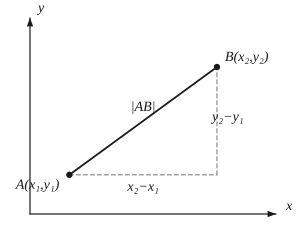
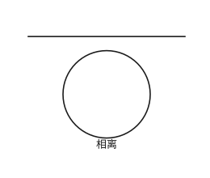
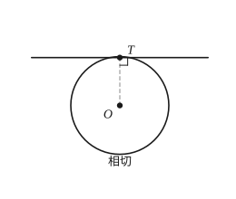
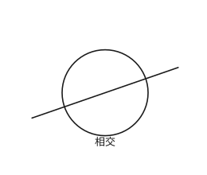
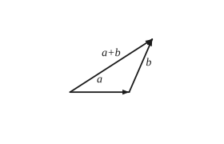
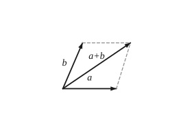
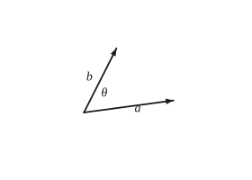

# 0.8 平面解析几何与向量

解析几何用坐标把“图形”变成“方程”。高数的第五章会把平面解析几何推广到空间：平面用一次方程表示，直线用两个平面相交或参数方程表示，球面和柱面用二次方程表示。这一节先把平面上的直线、圆和向量运算复习清楚，为空间解析几何搭好脚手架。

## 一、坐标与距离

*图 0-16 两点距离的直角三角形*

在平面直角坐标系中，点 $P$ 的坐标记作 $P(x,y)$。两点 $A(x_1,y_1)$、$B(x_2,y_2)$ 之间的距离为
$$
|AB|=\sqrt{(x_2-x_1)^2+(y_2-y_1)^2}.
$$
线段 $AB$ 的中点坐标为
$$
\left(\frac{x_1+x_2}{2},\ \frac{y_1+y_2}{2}\right).
$$
这两条公式都来自勾股定理：横坐标之差与纵坐标之差是直角三角形的两条直角边，距离是斜边。

**例 0.1** 求 $A(1,2)$ 与 $B(4,6)$ 之间的距离和中点。

**解**
$$
|AB|=\sqrt{(4-1)^2+(6-2)^2}=\sqrt{9+16}=5.
$$
中点为
$$
\left(\frac{1+4}{2},\frac{2+6}{2}\right)=\left(\frac{5}{2},4\right).
$$

## 二、直线方程

设直线经过点 $P_0(x_0,y_0)$，斜率为 $k$，则直线的**点斜式**方程为
$$
y-y_0=k(x-x_0).
$$
解出 $y$，得到**斜截式**
$$
y=kx+b,
$$
其中 $b$ 是直线与 $y$ 轴交点的纵坐标。直线的一般式方程为
$$
Ax+By+C=0\quad(A,B\text{ 不同时为零}).
$$
斜率
$$
k=\frac{y_2-y_1}{x_2-x_1}
$$
刻画直线的倾斜程度。当 $x_1=x_2$ 时，分母为零，直线垂直于 $x$ 轴，斜率不存在，方程写成
$$
x=x_0.
$$
所以“斜率不存在”不等于“没有直线”，只是不能用 $y=kx+b$ 表示。

两条直线平行的条件是斜率相等（或都不存在）；垂直的条件是
$$
k_1k_2=-1
$$
（或一条斜率为零、另一条斜率不存在）。

**例 0.2** 求经过 $A(1,3)$、$B(4,9)$ 的直线方程。

**解** 斜率
$$
k=\frac{9-3}{4-1}=2.
$$
用点斜式，取 $A(1,3)$：
$$
y-3=2(x-1),
$$
即
$$
y=2x+1.
$$

**例 0.3** 求过点 $(2,-1)$ 且与直线 $y=3x+4$ 垂直的直线方程。

**解** 已知直线斜率为 $3$，所求直线斜率 $k$ 满足 $3k=-1$，所以 $k=-\dfrac{1}{3}$。由点斜式
$$
y+1=-\frac{1}{3}(x-2),
$$
即
$$
x+3y+1=0.
$$

## 三、圆的方程

圆心为 $(a,b)$、半径为 $r$ 的圆，标准方程为
$$
(x-a)^2+(y-b)^2=r^2.
$$
展开后得到一般式
$$
x^2+y^2+Dx+Ey+F=0.
$$
反过来，看到一般式，用配方法找出圆心和半径：
$$
\left(x+\frac{D}{2}\right)^2+\left(y+\frac{E}{2}\right)^2=\frac{D^2+E^2}{4}-F.
$$
右端必须大于零，才表示一个实圆；等于零表示一个点；小于零不表示任何图形。

**例 0.4** 求圆 $x^2+y^2-4x+6y-3=0$ 的圆心和半径。

**解** 配方：
$$
(x^2-4x+4)+(y^2+6y+9)=3+4+9,
$$
即
$$
(x-2)^2+(y+3)^2=16.
$$
圆心为 $(2,-3)$，半径为 $4$。

## 四、直线与圆的位置关系

*图 0-17a 直线与圆相离*

*图 0-17b 直线与圆相切*

*图 0-17c 直线与圆相交*

判断直线与圆的位置关系，最方便的方法是比较**圆心到直线的距离** $d$ 与半径 $r$：

- $d<r$：直线与圆相交于两点；
- $d=r$：直线与圆相切；
- $d>r$：直线与圆相离。

点 $P(x_0,y_0)$ 到直线 $Ax+By+C=0$ 的距离公式为
$$
d=\frac{|Ax_0+By_0+C|}{\sqrt{A^2+B^2}}.
$$
这个公式在空间解析几何里会推广为点到平面的距离。

**例 0.5** 判断直线 $3x+4y-10=0$ 与圆 $(x-1)^2+(y-2)^2=4$ 的位置关系。

**解** 圆心为 $(1,2)$，半径 $r=2$。圆心到直线的距离
$$
d=\frac{|3\cdot 1+4\cdot 2-10|}{\sqrt{3^2+4^2}}
=\frac{|3+8-10|}{5}=\frac{1}{5}<2.
$$
所以直线与圆相交于两点。

## 五、向量及其运算

*图 0-18a 向量加法的三角形法则*

*图 0-18b 向量加法的平行四边形法则*

*图 0-19 两向量的夹角与数量积*

**向量**既有大小又有方向。在平面直角坐标系中，向量可以用坐标表示：
$$
\vec a=(a_1,a_2).
$$
它的模（长度）为
$$
|\vec a|=\sqrt{a_1^2+a_2^2}.
$$
设 $\vec a=(a_1,a_2)$，$\vec b=(b_1,b_2)$，$\lambda\in\mathbb{R}$，则
$$
\vec a\pm\vec b=(a_1\pm b_1,\ a_2\pm b_2),\qquad \lambda\vec a=(\lambda a_1,\lambda a_2).
$$
**数量积**（点积）定义为
$$
\vec a\cdot\vec b=a_1b_1+a_2b_2.
$$
它也可以用夹角表示：
$$
\vec a\cdot\vec b=|\vec a|\,|\vec b|\cos\theta,
$$
其中 $\theta$ 是两向量的夹角。由此得到
$$
\cos\theta=\frac{\vec a\cdot\vec b}{|\vec a|\,|\vec b|}.
$$
两个非零向量垂直的充要条件是
$$
\vec a\cdot\vec b=0.
$$
两个非零向量平行的充要条件是存在实数 $\lambda$，使 $\vec a=\lambda\vec b$，用坐标写就是
$$
a_1b_2-a_2b_1=0.
$$

**例 0.6** 设 $\vec a=(1,2)$，$\vec b=(3,-1)$，求 $\vec a\cdot\vec b$、$|\vec a|$、$|\vec b|$ 以及两向量夹角的余弦。

**解**
$$
\vec a\cdot\vec b=1\cdot 3+2\cdot(-1)=1,
$$
$$
|\vec a|=\sqrt{1^2+2^2}=\sqrt{5},\qquad |\vec b|=\sqrt{3^2+(-1)^2}=\sqrt{10}.
$$
所以
$$
\cos\theta=\frac{1}{\sqrt{5}\sqrt{10}}=\frac{1}{5\sqrt{2}}=\frac{\sqrt{2}}{10}.
$$

## 六、易错点

1. **竖直线没有斜率。**  过 $(x_0,y_0)$ 的竖直线方程是 $x=x_0$，不能写成 $y=kx+b$。
2. **圆的一般式要先配方。**  圆心是 $\left(-\dfrac{D}{2},-\dfrac{E}{2}\right)$，不是 $\left(\dfrac{D}{2},\dfrac{E}{2}\right)$。
3. **点到直线距离公式的分子要加绝对值。**  距离非负，算出来为负说明点与法向量的方向关系，不是距离。
4. **点积是数，不是向量。**  $\vec a\cdot\vec b$ 的结果是一个实数，不能继续写成向量。
5. **向量平行与直线平行不是一回事。**  向量平行只看方向相同或相反，直线平行还要求不重合。

## 七、与高数的接口

- **第五章空间解析几何**：空间向量、数量积、向量积、平面方程、直线方程、点到平面距离，都是本节内容的三维推广。
- **导数**：曲线在某点的切线斜率就是导数；法线与切线垂直。
- **积分**：定积分可以求平面图形面积、旋转体体积，前提是能写出边界曲线方程。
- **向量值函数**：后续参数方程求导会用到向量。

## 练习

1. 求经过点 $(0,2)$、斜率为 $-3$ 的直线方程。
2. 求圆 $x^2+y^2+2x-4y=0$ 的圆心和半径。
3. 设 $\vec a=(2,-1)$，$\vec b=(1,3)$，求 $\vec a\cdot\vec b$ 与 $|\vec a+\vec b|$。
4. 判断直线 $x+y-1=0$ 与圆 $x^2+y^2=1$ 的位置关系。

**答案**

1. $y=-3x+2$，即 $3x+y-2=0$。
2. 配方得 $(x+1)^2+(y-2)^2=5$，圆心 $(-1,2)$，半径 $\sqrt{5}$。
3. $\vec a\cdot\vec b=2\cdot 1+(-1)\cdot 3=-1$；$\vec a+\vec b=(3,2)$，$|\vec a+\vec b|=\sqrt{13}$。
4. 圆心到直线距离 $d=\dfrac{|0+0-1|}{\sqrt{2}}=\dfrac{\sqrt{2}}{2}<1$，相交于两点。
